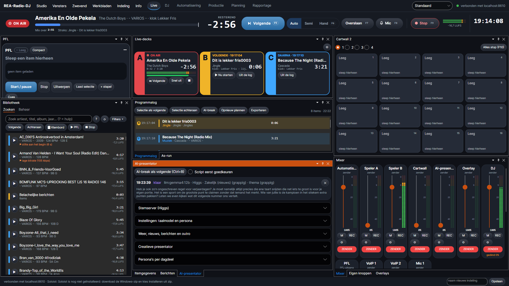
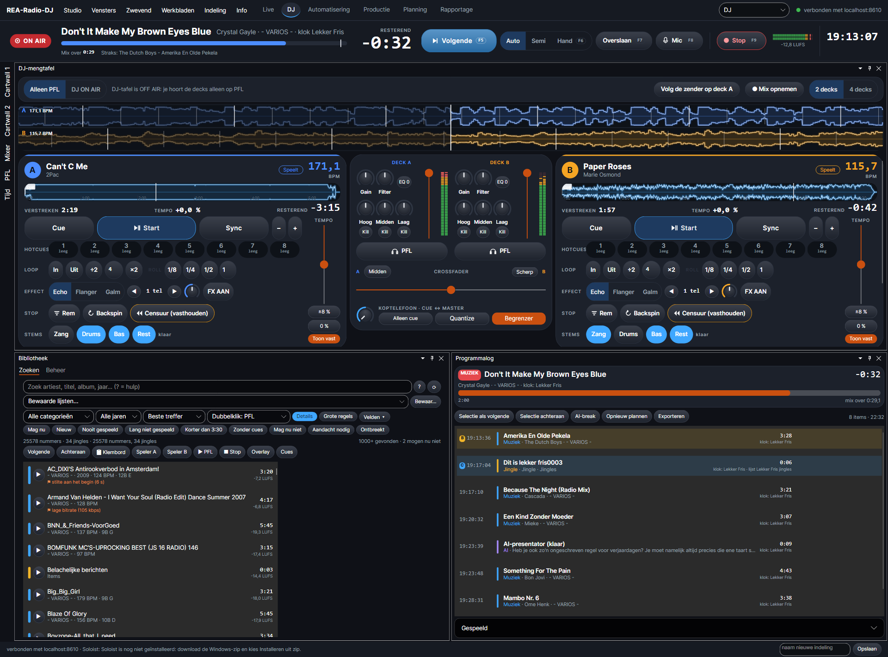
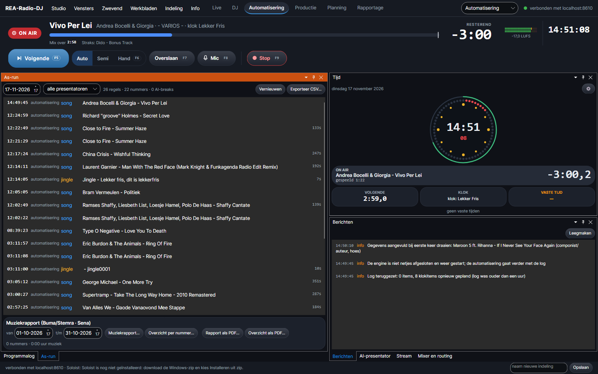
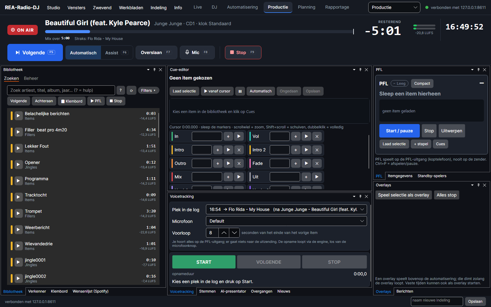
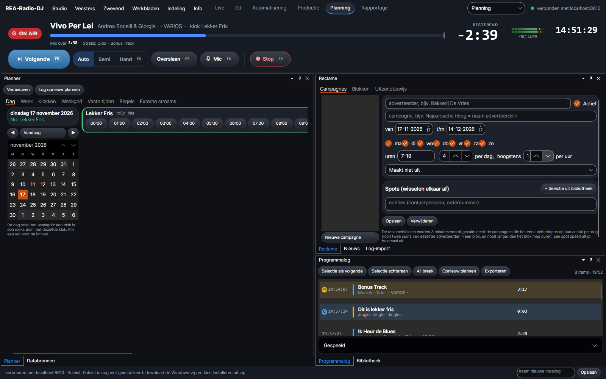
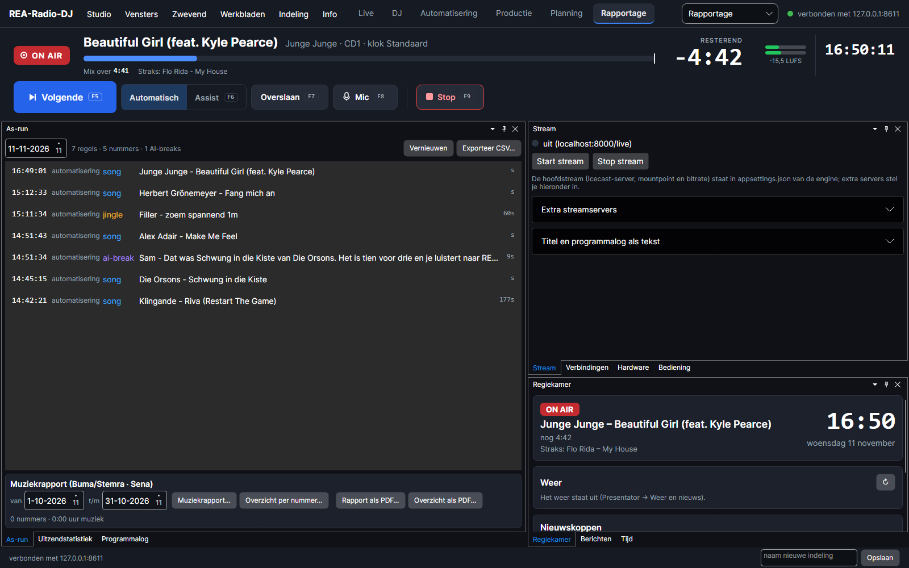
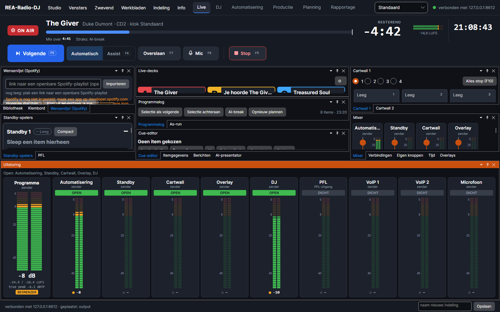
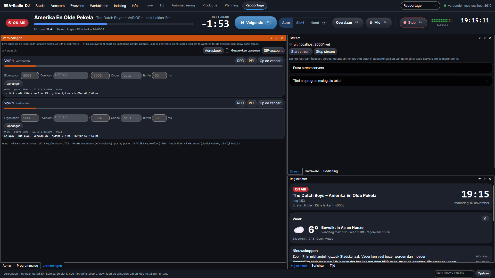

# REA-Radio-DJ

[Nederlands](README.md) · [English](README.en.md) · **Deutsch** · [Español](README.es.md)

Freies Radio-Playout mit eingebautem KI-Moderator, gemacht für Radio Aa en Hunze. Eine eigenständige Playout-Engine
(Dienst) und ein Desktop-Studio mit frei verschiebbaren, andockbaren und schwebenden Fenstern. Musik rund um die Uhr
automatisch oder Live-Assist, mit Uhren, festen Zeiten, Cartwalls, Standby- und PFL-Playern, einem DJ-Modus mit vier
Decks, zwei VoIP-Kanälen für Anrufer und Reporter und Steuerung über MIDI, Livewire, Ember+, OSC und TCP.

Studio, Webseiten und das Menü der Engine neben der Uhr sprechen Niederländisch, Englisch, Deutsch oder Spanisch
(*Einstellungen › Aussehen*); der KI-Moderator spricht seine eigene Sendesprache.

> Stand: in Entwicklung (Proof of Concept). Noch nicht für einen echten Sender gedacht. Was fertig ist und was noch
> offen ist, steht in [docs/WERKLIJST.md](docs/WERKLIJST.md) (niederländisch).

Wie man damit arbeitet, im Studio und als Administrator, steht im [Handbuch](docs/MANUAL.en.md) (englisch).

## Bildschirmfotos



| | |
|---|---|
|  |  |
| **DJ-Modus**: Decks mit Wellenform und Beatlinien, Stems (Gesang, Drums, Bass, Rest), Mischpult und Effekte | **Automatisierung**: Sendeablauf mit KI-Moderator, Uhr und Meldungen |
|  |  |
| **Produktion**: Bibliothek, Cue-Editor, Voicetracking und PFL | **Planung**: Tag, Woche, Uhren und feste Zeiten, Werbekampagnen |
|  |  |
| **Berichte**: As-run, Musikbericht (CSV und PDF), Stream und Regieraum | **Ausgabe**: Programm mit Lautheit und pro Kanal ein Meter mit OFFEN/ZU |
|  | |
| **Verbindungen**: zwei VoIP-Leitungen, hier mit Opus, mit Verlust, Jitter und Puffer | |

Jedes Fenster lässt sich verschieben, andocken oder schwebend lassen, auch auf einem zweiten Bildschirm.

## Was es kann

### Sendung und Betriebssicherheit
- **Engine als Dienst**: `REA-Radio-DJ.exe` spielt die Sendung, auch wenn das Studio geschlossen ist. Alles ist über
  REST (`/api/...`) steuerbar, mit Live-Status über WebSocket (`/api/ws`) oder Server-Sent Events (`/api/events`).
- **Watchdog**: ein kleiner Wächterprozess startet die Engine nach einem Absturz oder Hänger neu, und sie macht dort
  weiter, wo der Ablauf war. Die Engine kann mit Windows starten, unabhängig vom Studio.
- **Überwachung der Soundkarte**: stellt Windows oder ein anderes Programm die Karte des Senders leiser oder stumm,
  kommt eine Meldung, oder die Engine stellt sie sofort zurück. Hört eine ASIO-Karte beim Spielen auf, startet die
  Engine sie neu und meldet es; kommt sie nicht zurück, versucht sie es alle 10 Sekunden.
- **Weicher Start mit Grenze**: ein weicher Nachrichten- oder Werbeblock wartet auf das Ende des Elements, aber
  höchstens so lange wie eingestellt (*Einstellungen › Mixen*); dauert es länger, startet der Block sofort und das
  Element blendet aus.
- **Spieldauer pro Art und Kategorie**: eine längste Spieldauer (z. B. Jingles höchstens 30 Sekunden), und kurze
  Elemente, die immer ganz ausspielen, ohne Blende.
- **Moderationstext**: pro Titel, Werbung oder Ansage ein Text, den du dazu sagst; solange das Element spielt, steht er
  groß in der Live-Leiste.
- **Stilleerkennung** auf dem Sender: Schwelle, Dauer und Aktion (melden, Automatisierung starten oder etwas aus einer
  Notfallkategorie spielen).
- **Reservestudio**: eine zweite Engine überwacht das Hauptstudio und übernimmt die Sendung, wenn es ausfällt, eine
  Störung meldet oder (wenn du das wählst) still wird; spielt das Hauptstudio wieder, gibt es die Sendung nach einer
  eingestellten Zeit oder per Knopf zurück (*Einstellungen › Reservestudio*).
- **Sicherung** von Einstellungen, Uhren, Planung, Cartwalls und Hardware in einer Datei, und ein Systemprotokoll im
  Studio. Die Engine kann das **jeden Tag automatisch** zu einer festen Zeit tun, in einen Ordner auf einer anderen
  Festplatte oder einem NAS, mit Aufbewahrungsfrist; eine verpasste Nacht wird nachgeholt (*Einstellungen › System*).
- **Portübersicht**: welche Ports die Engine benutzt (ein oder aus, nur dieser PC oder das Netzwerk), mit einem
  PowerShell-Befehl für die Firewall, der nur die nötigen Ports öffnet (*Einstellungen › System*).

### Playout und Planung
- **BASS-Mixer** (32-Bit-Float), Crossfades am Mixpunkt, Lautheitsnormalisierung auf −16 LUFS (EBU R128), Übergänge
  und Mixpunkte pro Elementart und pro Titel.
- **Stundenuhren und Wochenraster**, mit festen Zeiten: *hart* (auf die Sekunde), *weich* (nach dem aktuellen Titel)
  oder *Overlay* (darüber, die Musik wird abgesenkt). Regeln für die Rotation, **Container** (ein Block als eine Zeile im
  Ablauf) und **externe Streams**, die in einem Zeitfenster das Programm übernehmen.
- **Playlist als Quelle** in einer Uhr: ein Platz spielt den nächsten (oder einen zufälligen) Titel aus einer M3U-,
  PLS- oder XSPF-Datei, auch wenn ein anderes Programm diese Liste schreibt. Nur Dateien aus der Bibliothek spielen;
  *Prüfen* zeigt, wie viele das sind.
- **Ereignisse an einer Stelle im Titel**: eine Lautstärkehüllkurve oder ein Befehl zu einem Zeitpunkt, im Cue-Editor
  zu setzen.
- **Spielweise AUTO, SEMI und HAND**: der Ablauf läuft von selbst, du steigst ein (der Ablauf wartet auf deinen eigenen
  Titel), oder du startest alles selbst. Der Ablauf kann **unter den Fadern** laufen: Musik auf Player A/B, Jingles auf
  der Cartwall und KI-Breaks auf dem KI-Moderator, jeweils mit eigenem Fader, der mitläuft.
- **Studio-Player**: Standby-Player mit Stapel, ein PFL-Player, Cartwalls mit 4 × 16 Tasten, Overlays und eine
  Zwischenablage zum Parken von Titeln.

### Bibliothek
- **SQLite-Bibliothek** mit dem vollständigen Cue-Modell (Cue-In, Intros, Outro, Mix, Cue-Out, Hook) und einem
  Cue-Editor mit Wellenform.
- **Ordner und Freigaben überwachen**: neue, geänderte und gelöschte Dateien werden von selbst verarbeitet; verschobene
  Dateien werden mit ihren Cues und ihrer Geschichte wiedergefunden.
- **Messen beim Einlesen**: BPM und Beatgrid, Tonart, ReplayGain, Lautheitsverlauf und geschätzte Intro- und
  Outro-Marker, dazu eine Qualitätsprüfung (zu leise, Clipping, Stille, niedrige Bitrate, doppelte Titel).
- **Suchen** ohne Akzente und mit kleinen Tippfehlern, kurze Filter (`bpm:120-128`, `jaar:198`, `duur:<3:30`),
  Filtertasten, intelligente Listen, „darf das jetzt?“ pro Titel und ein Detailbereich. Schnell bei 100.000 Titeln.
- **Nachschlagen am Klang**: mit AcoustID wird ein Titel zuerst an seinem Fingerabdruck erkannt, danach an den Tags;
  Titel, die bald in den Ablauf kommen, werden vorab nachgeschlagen, damit Cover und Daten rechtzeitig da sind.
- **Einzelne Dateien**, die aus dem Explorer in den Ablauf oder einen Player gezogen werden, kommen in die Kategorie
  *Einzelne Dateien* (nicht in der Rotation) und bekommen so auch ein Cover und Metadaten.
- **Tags lesen und zurückschreiben**, Cover, mehr Tagfelder (ISRC, Komponist, Verlag) und Rückgängig.

### Mischpult und Klang
- **Mischkanäle** für Automatisierung, Standby, Cartwalls, Overlays, DJ, Mikrofone, Line-In, VoIP und Vorhören, jeweils
  auf eine eigene Windows-Karte, ein Kanalpaar oder einen ASIO-Ausgang.
- **Kanalzug** pro Kanal: Gain, Balance, Equalizer, Kompressor, automatische Pegelregelung, Stumm, auf Sendung,
  Aufnahme (REC), ein eingebauter Effekt und Plätze für VST-Effekte.
- **LED-Meter** in dBFS mit Spitzenhaltung in den Decks, im Mixer, im DJ-Zug und in der oberen Leiste; das Deck auf
  Sendung hat einen Signalbalken und meldet *kein Ton*, wenn es still bleibt.
- **Fenster Ausgabe**: das Programm mit Spitze, Lautheit (kurz und integriert), True Peak und Begrenzer, und pro Kanal
  ein großes Meter mit einer Lampe OFFEN, ZU oder MIC OFFEN; lesbar von der anderen Seite des Studios.
- **Master** mit Begrenzer und Lautheitsmeter. Arbeitsweise *Software* (die Engine mischt) oder *Mischpult* (jeder Kanal
  auf seinen eigenen Ausgang).

### DJ-Modus
- Vier Decks mit laufenden Wellenformen und Beatlinien, Sync, Hot Cues, Loops und Loop-Roll, Quantize, Effekte auf
  dem Beat, Zensur, Bremse und Backspin, ein Sampler, Cue-Mix auf dem Kopfhörer und ein Begrenzer.
- **Stems**: pro Deck Gesang, Drums, Bass und Rest einzeln an oder aus, zum Beispiel für eine Instrumentalversion. Sie
  werden im Hintergrund auf dem Prozessor erzeugt (HT-Demucs, mit niedriger Priorität) und bis 20 GB aufbewahrt. Das
  Modell (`data\models\htdemucs.onnx`) ist nicht im Download enthalten.
- **Automix** auf 2 oder 4 Decks mit Übergangsarten (auch über die Kanalfader), und die Automatisierung läuft unhörbar
  weiter, während der DJ auf Sendung ist.
- Mix aufnehmen; Steuerung der Decks über den Befehlsbus und MIDI-Lernen. *Noch nicht angehört.*

### Verbindungen (VoIP)
- Zwei VoIP-Mischkanäle mit eigenem Fader, Vorhören und einem Rückkanal ohne sich selbst (Mix-Minus).
- **RTP** in beide Richtungen mit Opus (48 kHz), G.722 (16 kHz Breitband), G.711 (A-law, µ-law) und linearem PCM, mit
  Jitterpuffer und Messung; bei Opus füllt der Codec ein verlorenes Paket selbst auf.
- **SIP**: anrufen, angerufen werden und an einer Telefonanlage anmelden, mit NAT-Unterstützung. *Noch nicht beim
  Anbieter getestet.*
- **Adressbuch** mit Stationen (SIP-Nummer oder feste RTP-Leitung), Signale bei Klingeln und Verbinden, Lampen und
  Tallies, und **Gespräche aufnehmen** (von Hand oder automatisch, mit Aufbewahrungsfrist).

### Aufnehmen, Streamen und Berichte
- Die Sendung als MP3 pro Uhrstunde und das Mikrofon getrennt, wahlweise direkt in die Bibliothek, mit
  Aufbewahrungsfrist.
- **Nur das Sprechen aufnehmen** als Mitschnitt: das Mikrofon oder ein Eingang, nur solange er offen ist und Ton da ist
  (Schwelle und Nachlaufzeit), mit einer halben Sekunde vor dem Einsatz; eine MP3 pro Stunde ohne die Musik dazwischen.
- **Aus der Sendung schneiden**: das Interview von eben als Element in der Bibliothek. Wähle einen Tag und eine
  Anfangs- und Endzeit (oder *letzte 10 Min*); das Stück darf über die volle Stunde gehen. Funktioniert mit dem
  Sendemitschnitt (Einstellungen › Aufnehmen).
- **Streams** zu mehreren Icecast- und SHOUTcast-Servern gleichzeitig, mit Titelaktualisierung in eigenem Format.
- **Sendeablauf drucken oder exportieren** (PDF und CSV) mit den erwarteten Startzeiten: *Sendeablauf › Exportieren*.
- **As-run** und ein Sendeablauf als Textdatei pro Tag; Urheberrechtsberichte (CSV und PDF), Werbe-Sendeberichte pro
  Werbekunde und Sendestatistik.

### KI-Moderator
- Text über jeden OpenAI-kompatiblen Endpunkt (z. B. Ollama) oder eingebaute Vorlagen, Stimme über Higgs TTS 3 oder
  Windows-Sprachausgabe. Breaks werden vorab erstellt; die Sendung wartet nie auf die KI.
- **Sendesprache**: Niederländisch, Englisch, Deutsch oder Spanisch, wählbar neben dem Namen des Moderators;
  Sprachmodell, Vorlagen, Nachrichten und Wetter folgen ihr.
- **Stimmendatenbank**: ein Moderator nimmt eine eigene Stimme auf (Studiomikrofon) oder lädt eine hoch, mit Rollen für
  Moderator, Nachrichtensprecher und Wettersprecher; der Higgs-Server kann mit der Engine starten.
- Ein kreativer Moderator, der die Titel miteinander verbindet, auch mit denkenden Sprachmodellen.
- **KI-Nachrichten und Wetterbericht** als fester Nachrichtenblock: landesweite (z. B. die NOS) und regionale Quellen
  (z. B. RTV Drenthe), vom lokalen Sprachmodell zu einem Bulletin mit Quellenangabe umgeschrieben, oder ein Wetterbericht
  für einen gewählten Ort. Eigene Stimme, Nachrichtenbett darunter, Opener und Closer; z. B. regional um :30 und
  landesweit um :00. Nennt das Sprachmodell etwas, das nicht in der Quelle steht (eine Zahl), werden die Schlagzeilen
  wörtlich vorgelesen.

### Steuerung und Hardware
- Alles als Textbefehl: über HTTP, TCP, UDP, OSC, Tastenkürzel (auch außerhalb des Studios), eigene Tasten, den Planer
  und Ereignisse (Start eines Elements, Mikrofon offen, Stream weg).
- **Hardware**: MIDI, serielle Ports, Livewire-GPIO und Ember+, für Tasten, Lampen und Tallies. *Ember+ ist noch nicht
  an einem echten Gerät getestet.*
- **Mackie Control**: ein Bedienpult mit Motorfadern (z. B. iCON V1-M, mit einer Erweiterung wie dem V1-X daneben)
  bedient das Mischpult: Lautstärke, Balance, Stumm, Aufnahme und auf Sendung pro Kanal, mit Display und Metern; die
  Fader folgen dem Studio. Auf einem iCON V1-M legt REA seine eigene Belegung ins Pult, mit den Titeln pro Fader auf dem
  Bildschirm, einer DJ-Belegung mit Faderstart und dem Jogwheel durch den Ablauf. Getestet mit einem iCON V1-M.

### Das Studio
- **Https im Netzwerk** mit einem eigenen Zertifikat des Senders (Port 8443), und **Voicetracking aus dem Browser**:
  ein Moderator nimmt zu Hause eine Moderation mit dem Mikrofon von Laptop oder Telefon auf.
- **Zentrale Bibliothek**: eine Engine liest die Musik ein und misst sie; andere Studios übernehmen das und spielen von
  der Freigabe oder einer eigenen Kopie (*Einstellungen › Zentrale Bibliothek*).
- **Aus der Ferne**: eine Seite für Telefon und Tablet (`/remote/` auf der Engine) zeigt, was läuft und was kommt, mit
  großen Tasten für Start, Überspringen und Carts. Lesen geht von jedem Computer; jede Aktion über das Netzwerk verlangt
  einen angemeldeten Benutzer oder das Steuerpasswort.
- **Studiouhren** in drei Stilen: analog und digital zusammen, eine LED-Uhr mit Sekundenpunkten und eine Stundenuhr,
  die bis zur vollen Stunde herunterzählt.
- Ein Einrichtungsassistent beim ersten Start: Sendername, Farbstil, Musik- und Jingleordner und Soundkarten in vier
  Schritten (später unter *Studio › Einrichtungsassistent*).
- Arbeitsbereiche Live, DJ, Automatisierung, Produktion, Planung und Berichte, mit Arbeitsblättern pro Bildschirm.
- Mehrere Themes (dunkel, hell und mehr), einstellbare Schriftgröße und Skalierung, ein Touch-Modus und Farben pro
  Elementart.
- **Benutzer und Rechte**: Anmelden mit eigenem Namen und PIN, Rollen Moderator, Techniker und Administrator
  (*Einstellungen › Benutzer*); die Einstellungen sind dann nur für Administratoren. *Studio › Studio sperren* (Strg+L)
  hält die Sendung am Laufen und das Studio zu bis zur PIN; das As-run zeigt pro Moderator, was gesendet wurde. Ein Konto
  kann einen **letzten Tag** bekommen (Praktikant, Vertretung); danach kann sich die Person nicht mehr anmelden und wird
  abgemeldet. Wer aufhört, kann deaktiviert statt gelöscht werden. Nach einer einstellbaren Zahl falscher PINs wird ein
  Name eine Zeit lang gesperrt; ein Administrator kann das aufheben. PIN vergessen: starte die Engine auf diesem Computer
  mit `--users-off`.

## Installieren (Windows 10/11, x64)

Zu jeder [Version](https://github.com/jerrydeevee/REA-Radio-DJ/releases) gibt es ein Zip; ab 1.1.0 auch ein Setup
(`REA-Radio-DJ-<Version>-setup.exe`). .NET muss nicht separat installiert werden.

- Das Setup installiert für den eigenen Benutzer, ohne Administratorrechte, in `%LocalAppData%\Programs\REA-Radio-DJ`.
  Die Engine bewahrt ihre Datenbank, Musik und Aufnahmen neben sich auf (`engine\data`, `engine\media`).
- Das Setup legt REA-Radio-DJ ins Startmenü (Studio, Engine und Weboberfläche). Eine Desktopverknüpfung und der Start
  der Engine bei der Anmeldung sind Optionen im Setup.
- Ein neueres Setup installiert über das alte. Deinstallieren geht über Windows-Einstellungen › Apps: die Engine wird
  gestoppt, und `engine\data` und `engine\media` bleiben erhalten.
- Das Studio meldet eine neuere Version unten rechts (Info › Nach Updates suchen).

Ein Setup bauen geht mit [Inno Setup 6](https://jrsoftware.org/isinfo.php):
`powershell -ExecutionPolicy Bypass -File scripts\build-installer.ps1` (BASS muss in `native\` liegen).

## Schnellstart aus dem Quellcode

1. Installiere das [.NET 9 SDK](https://dotnet.microsoft.com/download).
2. Hole BASS (ist nicht im Repository):
   ```powershell
   powershell -ExecutionPolicy Bypass -File scripts\fetch-bass.ps1
   ```
3. Starte die Engine mit erzeugtem Demo-Audio (inklusive eines Nachrichten-Ereignisses jede Stunde um :00):
   ```powershell
   dotnet run --project src\ReaRadioDj.Server -- --demo
   ```
4. Starte das Studio:
   ```powershell
   dotnet run --project src\ReaRadioDj.Studio -- --lang de
   ```
   Das Studio verbindet sich mit `http://127.0.0.1:8600`. Läuft die Engine nicht, kannst du sie über das Menü *Studio*
   starten. Eine einfache Weboberfläche gibt es unter <http://localhost:8600>.

Eigene Musik: lege Dateien (mp3, wav, flac, ogg, aiff) in Unterordner von `media\music` (jeder Ordner wird eine
Kategorie) und Jingles in `media\jingles`, neben dem Ort, an dem du die Engine startest, oder stelle andere Ordner in
`appsettings.json` ein.

### Das Studio

- Jedes Fenster (Ablauf, Player, Cartwalls, Bibliothek, Cue-Editor, Mixer, Planer, As-run …) kannst du verschieben,
  nebeneinander oder als Registerkarte andocken oder schwebend lassen (Menü *Schwebend*), auch auf einem zweiten
  Bildschirm.
- Menü *Layout*: Layouts speichern, laden und zurücksetzen. Das letzte Layout wird beim Beenden gespeichert.
- Ziehen aus der Bibliothek in den Ablauf, einen Player oder eine Carttaste; Doppelklick = Vorhören (PFL).
- Tastenkürzel: F5 nächstes, F6 automatisch/Assist, F8 Mikrofon, F9 Stopp.
- Optionen: `--engine <url>`, `--no-engine`, `--profile <Ordner>` (eigener Einstellungsordner), `--lang <nl|en|de|es>`,
  `--show <Fenster>`, `--float <Fenster>`, `--workspace <live|dj|auto|prod|plan|report>`, `--setup`
  (Einrichtungsassistent öffnen).

## Einstellungen

Alles steht in [`src/ReaRadioDj.Server/appsettings.json`](src/ReaRadioDj.Server/appsettings.json), Abschnitt
`ReaRadioDj`. Du kannst alles mit Umgebungsvariablen überschreiben, zum Beispiel `ReaRadioDj__OutputDevice=0`.

| Einstellung | Bedeutung |
|---|---|
| `Language` | Sprache des Engine-Menüs neben der Uhr (`nl`, `en`, `de`, `es`); leer = die Sprache von Windows |
| `OutputDevice` | `-1` Standard-Soundkarte, `0` keine Soundkarte (nur Streamen), `1..` ein bestimmtes Gerät (siehe `/api/devices`) |
| `Mix.TargetLufs` | Ziel-Lautheit, Standard −16 |
| `Rotation.ArtistSeparation` / `SongSeparation` | nicht derselbe Interpret / derselbe Titel innerhalb so vieler Titel |
| `Routing.PreviewDevice` | Soundkarte für PFL (Vorhören) |
| `Routing.MicEnabled` / `MicDevice` / `MicDuckLevel` | Mikrofon aufnehmen, Eingabegerät, Musikpegel bei offenem Mikrofon |
| `Routing.OverlayDuckLevel` / `StandbyPlayers` | Musikpegel unter Overlays, Anzahl Standby-Player |
| `Presenter.Language` | die Sendesprache des KI-Moderators (`nl`, `en`, `de`, `es`) |
| `Presenter.Llm.BaseUrl` / `Model` | zum Beispiel `http://localhost:11434` und `llama3.1` für Ollama; leer = Vorlagen |
| `Presenter.Tts.Provider` | `sapi` (Windows) oder `higgs` |
| `Presenter.Tts.BaseUrl` | Higgs-Server, Standard `http://localhost:8001` |
| `Presenter.Tts.Tags` | Higgs-Steuertags vor jedem Break, z. B. `<\|emotion:enthusiasm\|>`; pro Stimme im Fenster *Stimme* einstellbar |
| `Stream.*` | Icecast-Server (`host:port/mount`), Passwort, Bitrate |

### Higgs TTS 3 verwenden

Higgs läuft als eigener Server (SGLang-Omni) in WSL mit einer NVIDIA-GPU. Die Skripte stehen in `tools/higgs`:

```bash
# in WSL (Ubuntu): einmalig ein C-Compiler, danach Server und Modell (~9 GB) in ~/higgs
sudo apt-get install -y build-essential
mkdir -p ~/higgs && cp tools/higgs/*.sh ~/higgs/ && bash ~/higgs/install.sh
bash ~/higgs/pin.sh      # RTX-50-Serie: CUDA-Compiler an die CUDA-13.0-Runtime angleichen
~/higgs/start.sh         # Server auf Port 8001; Referenzclips in ~/higgs/voices
```

Das Studio kann den Server auch selbst starten und stoppen (Fenster *Stimme*): `Presenter.Tts.ServerCommand` steht auf
`wsl.exe` mit `-d Ubuntu -- bash -lc ~/higgs/start.sh`; mit `StartServer` = `true` startet er mit der Engine. Beachte
die Lizenz des Modells: *Boson Higgs TTS 3 Research and Non-Commercial License*.

Stelle danach `Presenter.Tts.Provider` auf `higgs`. Für eine eigene Stimme füllst du `ReferenceAudio` (ein Pfad oder
eine URL, die der **Server** lesen kann) und `ReferenceText` (was in diesem Ausschnitt gesagt wird) aus. Versagt Higgs,
fällt REA-Radio-DJ auf die Windows-Sprachausgabe zurück.

## Aufbau

```
src/ReaRadioDj.Core       Audio-Engine und Mixer (BASS), Analyse, Bibliothek (SQLite), Uhren, feste Zeiten,
                          Studio-Player, Cartwall, DJ-Decks, VoIP (RTP, SIP), Hardware, As-run,
                          KI-Moderator, Streams
src/ReaRadioDj.Contracts  die Nachrichten (DTOs) zwischen Engine und Studio, und die Übersetzungen (strings.tsv)
src/ReaRadioDj.Server     der Engine-Dienst: REST, WebSocket, Server-Sent Events, Automatisierung, Web-UI
src/ReaRadioDj.Studio     das Desktop-Studio (Avalonia + Dock): andockbare und schwebende Fenster
tests/ReaRadioDj.Tests    Unit-Tests und Audiotests (laufen auf dem "no sound"-Gerät von BASS)
scripts/fetch-bass.ps1   lädt BASS nach /native
scripts/strings.py       hält die Übersetzungstabelle aktuell
scripts/build-installer.ps1, installer/   bauen das Windows-Setup (Inno Setup 6)
```

Der Mixer besteht aus verschachtelten BASS-Mixern: Ausgänge (Sendung, PFL) → Kanäle → Quellen. Eine Steuerschleife von
10 ms startet das nächste Ablaufelement am Mixpunkt. Absenken (Mikrofon, Overlays, KI-Breaks) geht pro Kanal mit einem
Grund, sodass mehrere Ursachen sich nicht in die Quere kommen. Die Engine spielt nur Material, das bereitsteht.

## Übersetzungen

Der niederländische Text ist der Schlüssel; [`strings.tsv`](src/ReaRadioDj.Contracts/Localization/strings.tsv) hat
Englisch, Deutsch und Spanisch daneben. Nach neuen oder geänderten Texten: `python scripts/strings.py` ausführen und
die leeren Zellen ausfüllen; ein Test schlägt fehl, solange ein Text, den der Code verlangt, keine Übersetzung hat.

## Tests

```powershell
dotnet test
```

Gut 700 Tests decken unter anderem Cuepunkte, Uhrplanung, feste Zeiten, die Datenbank, die Bibliothek und die Suche,
den Befehlsbus, Hardwaresignale, RTP und SIP und die Übersetzungen ab. Die Audiotests laufen nur, wenn BASS vorhanden
ist: sie spielen echtes Audio auf dem stillen Gerät (Engine, Cartwall, Standby, Absenken, Aufnehmen, Bibliotheksscan)
und starten einen Fake-Icecast-Server für den Stream.

Was sich nur mit Ohren oder echter Hardware prüfen lässt (DJ-Modus, KI-Nachrichten, ASIO, SIP, Ember+, Mackie Control),
steht in [docs/TESTPLAN.md](docs/TESTPLAN.md), mit einer Liste, um getestete Geräte festzuhalten.

## Lizenz

GPL-3.0 oder später, mit einer zusätzlichen Erlaubnis, mit BASS zu linken. Siehe [NOTICE.md](NOTICE.md) für BASS,
Higgs TTS 3 und die anderen Bestandteile.

REA-Radio-DJ ist ein eigener Entwurf. Es funktioniert ähnlich wie bekannte Playout-Programme, verwendet aber keinen
Code, keine Bildschirme, Namen oder Dateiformate davon.

## Fernsteuerung

Alles, was du im Studio kannst, geht auch mit Textbefehlen (`NEXT`, `AUTO OFF`, `CART 1 5`, `MIC TOGGLE`,
`VOLUME log 80`, `STREAM START` …). Die Liste steht im Studio unter **Studio › Steuerung und Tastenkürzel** und unter
`GET /api/commands`. Dieselben Befehle funktionieren über:

- **HTTP**: `POST /api/command` mit `{"text":"NEXT"}`, oder eine Webadresse pro Taste: `/api/do/next`, `/api/do/cart/1/5`
- **TCP** (Port 8601): ein Befehl pro Zeile, Antwort `OK …` oder `ERR …`; mit Passwort zuerst `AUTH <Passwort>`
- **Befehlszeile**: `rea-cmd NEXT`, `rea-cmd "AUTO OFF" "CART 1 5"` oder `rea-cmd --file befehle.txt` (liegt neben der
  Engine). Das Passwort kommt aus der Umgebungsvariable `REA_CONTROL_PASSWORD`; Exitcode 0 = alles OK, 1 = ein Befehl
  gab ERR, 2 = keine Verbindung. Praktisch in einer Aufgabenplanung oder einem Skript.
- **OSC** (UDP 8602): `/rea/next`, `/rea/cart/1/5`, `/rea/mic/toggle`, `/rea/cmd "AUTO OFF"` (Wert 0 = Loslassen, ignoriert)
- **UDP** (Port 8603): ein Befehl pro Paket, mit Antwort zurück
- **MIDI, seriell, Livewire und Ember+**: Tasten und Fader auf einen Befehl, Lampen und Tallies auf einen Zustand
- **Tastenkürzel** im Studio (frei einstellbar) und **feste Zeiten** im Planer (Aktion *Befehl ausführen*)

Eine Fernbedienung, die nur einen Teil darf (ein Tablet nur die Cartwall, ein Tastenkasten nur `NEXT`), stellst du unter
**Einstellungen › Aus der Ferne › Fernbedienungen mit eigenen Rechten** ein. Sie bekommt einen eigenen Schlüssel statt
des Passworts (TCP `AUTH <Schlüssel>`, UDP `<Schlüssel> NEXT`, Web `/api/do/next?key=<Schlüssel>`, `rea-cmd` über
`REA_CONTROL_PASSWORD`) oder wird ohne Schlüssel an ihrer festen Adresse erkannt. Sie darf nur die angehakten
Befehlsgruppen benutzen; `STATUS` und `HELP` gehen immer.

Standardmäßig hört das nur auf diesem Computer. Für das Netzwerk in `appsettings.json`:

```json
"ReaRadioDj": { "Control": { "BindAddress": "0.0.0.0", "TcpPort": 8601, "OscPort": 8602, "Password": "geheim" } }
```

Der Planer kennt außerdem **Regeln** (z. B. höchstens 2 aus derselben Kategorie hintereinander; überspringen oder
verschieben) und **externe Streams**: eine Icecast/SHOUTcast-URL, die in einem Zeitfenster überwacht wird und, sobald
sie live ist, das Programm übernimmt oder darüber spielt.
