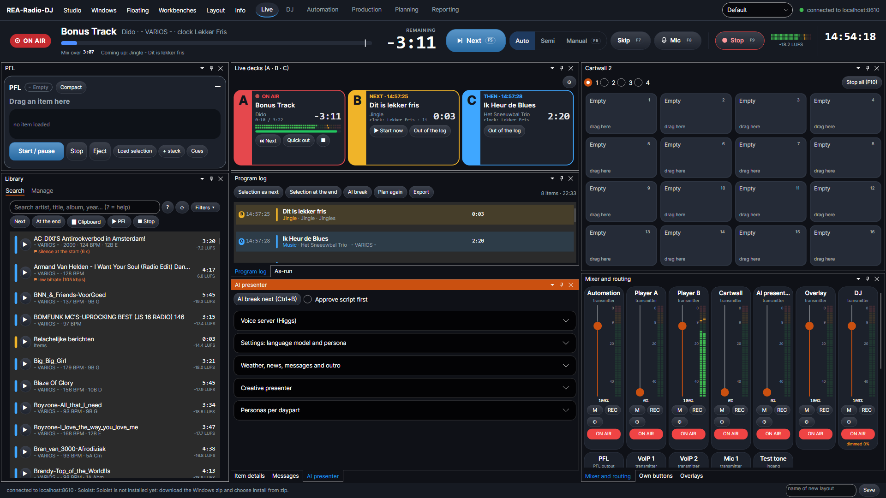
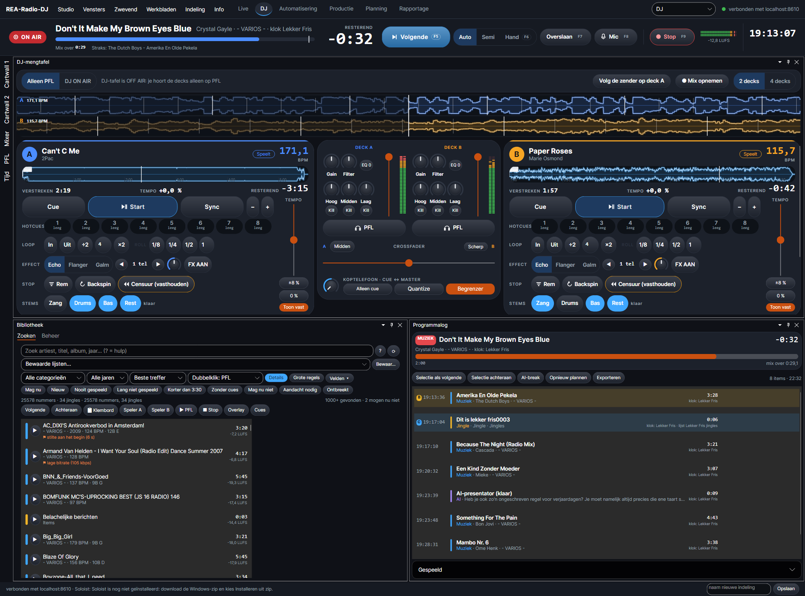
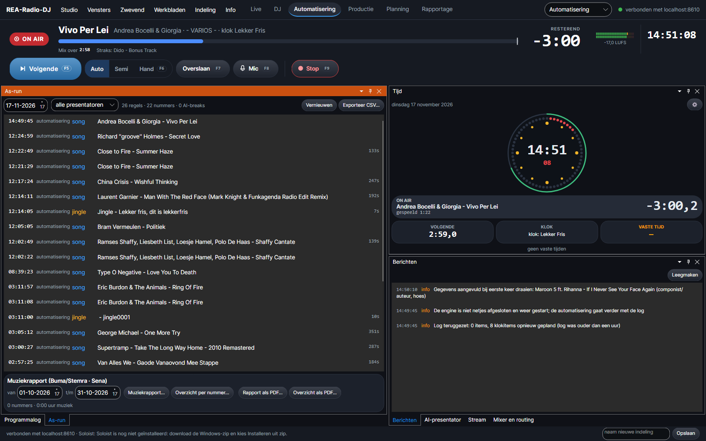
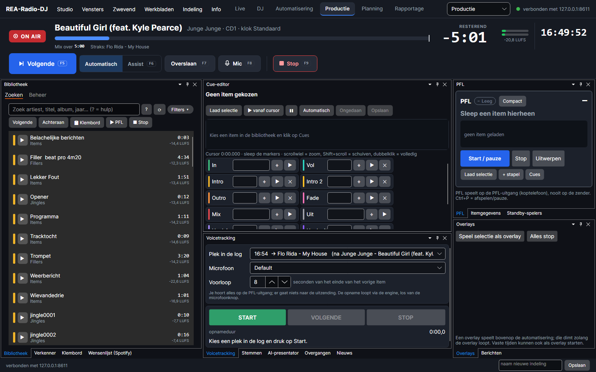
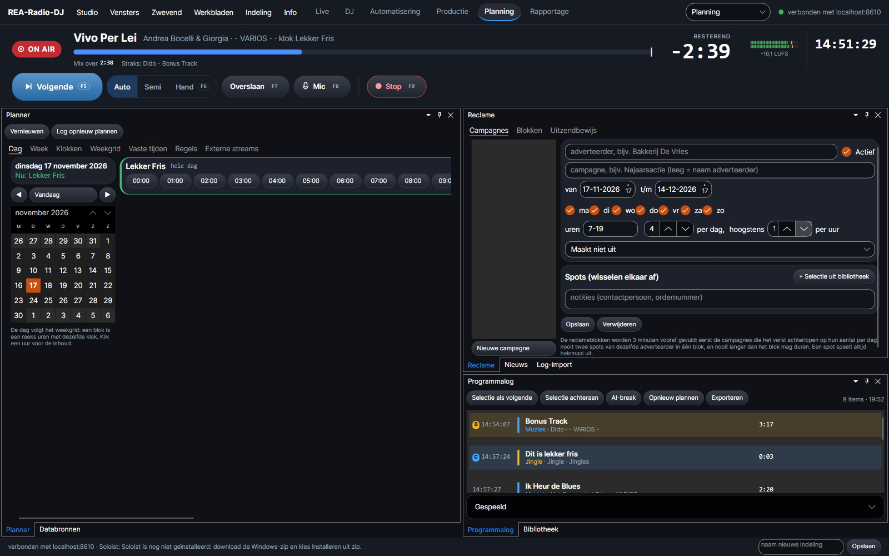
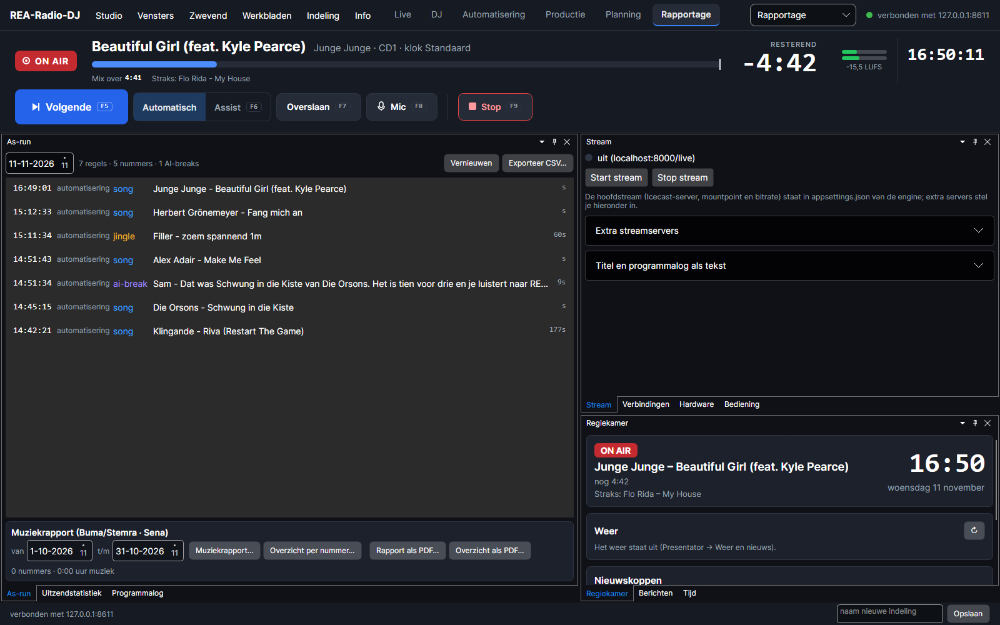
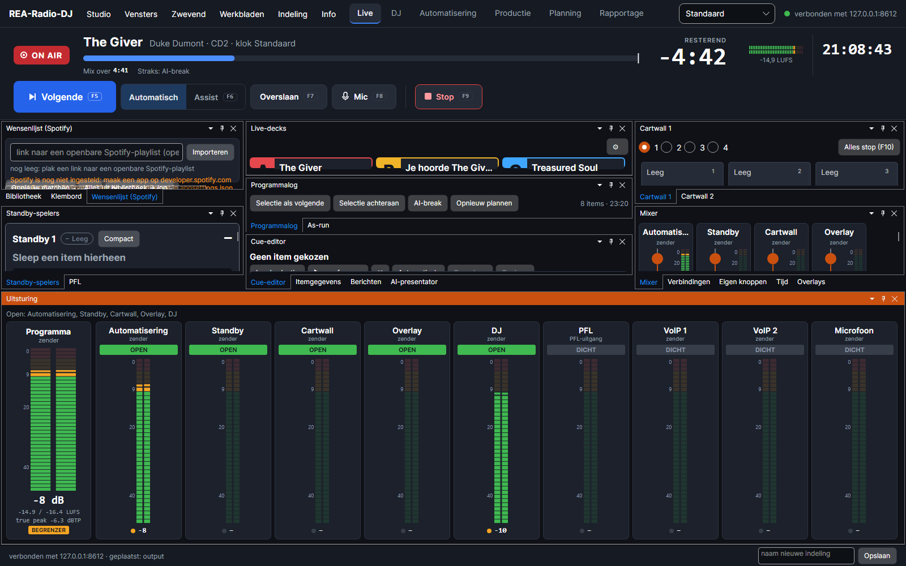
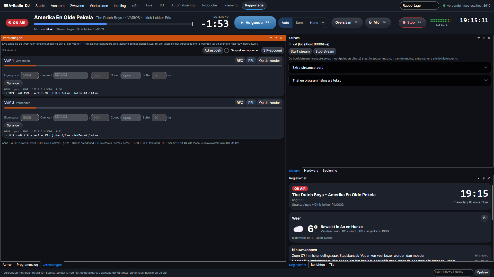
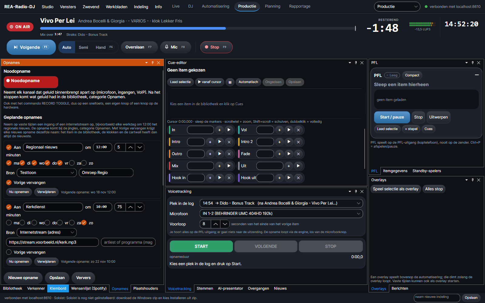
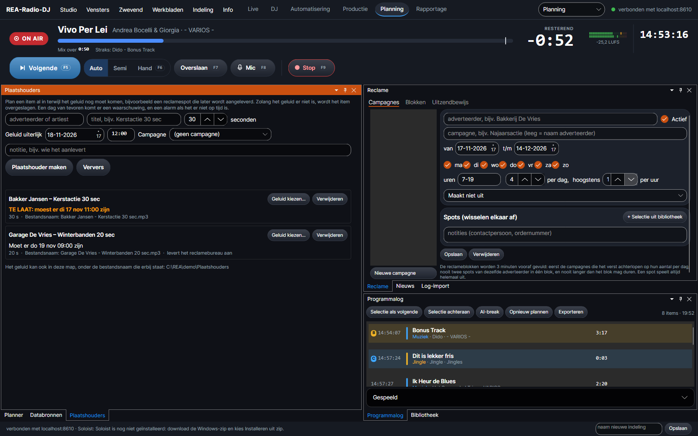

# REA-Radio-DJ

[Nederlands](README.md) · **English** · [Deutsch](README.de.md) · [Español](README.es.md)

Free radio playout with a built-in AI presenter, made for Radio Aa en Hunze. A separate playout engine (service) and a
desktop studio with freely movable, dockable and floating windows. Music 24/7 automatically or live assist, with
clocks, fixed times, cart walls, standby and PFL players, a DJ mode with four decks, two VoIP channels for callers and
reporters, and control through MIDI, Livewire, Ember+, OSC and TCP.

The studio, the web pages and the engine's tray menu speak Dutch, English, German or Spanish (*Settings ›
Appearance*); the AI presenter speaks its own on-air language.

> Status: in development (proof of concept). Not yet meant for a real station. What is ready and what is still open
> is in [docs/WERKLIJST.md](docs/WERKLIJST.md) (Dutch).

How to work with it, in the studio and as an administrator, is in the [manual](docs/MANUAL.en.md).

## Screenshots



| | |
|---|---|
|  |  |
| **DJ mode**: decks with waveform and beat lines, stems (vocals, drums, bass, other), mixer and effects | **Automation**: as-run with what has played, the clock with what is coming, and the messages |
|  |  |
| **Production**: library, cue editor, voice tracking and PFL | **Planning**: day, week, clocks and fixed times, ad campaigns |
|  |  |
| **Reporting**: as-run, music report (CSV and PDF), stream and control room | **Outputs**: programme with loudness and per channel a meter with OPEN/CLOSED |
|  |  |
| **Connections**: two VoIP lines, here with Opus, with loss, jitter and buffer | **Recordings**: the one-button emergency recorder, and scheduled recordings of an input or stream (e.g. the regional news) |
|  | |
| **Placeholders**: plan a spot already; a warning beforehand and an alarm if it is late | |

Every window can be dragged, docked or left floating, also on a second screen.

## What it does

### Broadcast and reliability
- **Engine as a service**: `REA-Radio-DJ.exe` plays the broadcast, also when the studio is closed. Everything can be
  controlled over REST (`/api/...`), with live status over WebSocket (`/api/ws`) or server-sent events (`/api/events`).
- **Watchdog**: a small guard process restarts the engine after a crash or hang, and it carries on where the log was.
  The engine can start with Windows, separately from the studio.
- **Sound card guard**: if Windows or another program turns the station's card down or mutes it, you get a notice, or
  the engine puts it back at once. If an ASIO card stops while playing, the engine restarts it and reports it; if it
  does not come back, it tries again every 10 seconds.
- **Soft start with a limit**: a soft news or ad block waits for the end of the item, but no longer than set
  (*Settings › Mixing*); if it takes longer, the block starts at once and the item fades out.
- **Play length per type and category**: a longest play length (e.g. jingles at most 30 seconds), and short items that
  always play to the end without fading.
- **Presenter text**: per song, ad or announcement a text you say with it; while the item plays it is shown large in
  the Live bar.
- **Silence detection** on air: threshold, duration and action (notify, start automation or play something from an
  emergency category).
- **Backup studio**: a second engine watches the main studio and takes over the broadcast when it fails, reports a
  fault or (if you choose so) goes silent; when the main studio plays again, it hands the air back after a set time or
  with a button (*Settings › Backup studio*).
- **Backup** of settings, clocks, planning, cart walls and hardware in one file, and a system log in the studio. The
  engine can do that **automatically every day** at a fixed time, into a folder on another disk or a NAS, with a
  retention period; a missed night is caught up (*Settings › System*).
- **Port overview**: which ports the engine uses (in or out, this PC only or the network), with a PowerShell command for
  the firewall that opens only the ports needed (*Settings › System*).
- **Messages by mail** (SMTP): silence on air, the backup studio taking over, a failed backup, an ASIO card that
  drops out or a placeholder without sound, also outside the studio. At most one mail per topic per so many minutes
  (*Settings › Messages by mail*).
- **Database check before an upgrade**: the engine checks the database and makes a copy before it updates it. If it
  is damaged it is left untouched and the engine says plainly what is wrong. `REA-Radio-DJ.exe --check-db` does it
  beforehand.

### Playout and planning
- **BASS mixer** (32-bit float), crossfades at the mix point, loudness normalisation to −16 LUFS (EBU R128),
  transitions and mix points per item type and per song.
- **Hour clocks and week grid**, with fixed times: *hard* (to the second), *soft* (after the current song) or
  *overlay* (on top, the music ducks). Rotation rules, **containers** (a block as one line in the log) and **external
  streams** that take over the programme in a time window.
- **Playlist as a source** in a clock: a slot plays the next (or a random) song from an M3U, PLS or XSPF file, also when
  another program writes that list. Only files from the library play; *Check* shows how many those are.
- **Events at a point in a song**: a volume envelope or a command at a moment, set in the cue editor.
- **Play modes AUTO, SEMI and MANUAL**: the log runs by itself, you step in (the log waits for your own song), or you
  start everything yourself. The log can run **under the faders**: music on player A/B, jingles on the cart wall and AI
  breaks on the AI presenter, each with its own fader that moves along.
- **Studio players**: standby players with a stack, a PFL player, cart walls of 4 × 16 buttons, overlays and a
  clipboard to park songs.

### Library
- **SQLite library** with the full cue model (cue in, intros, outro, mix, cue out, hook) and a cue editor with waveform.
- **Watching folders and shares**: new, changed and removed files are processed by themselves; moved files are found
  back with their cues and history.
- **Measuring on import**: BPM and beat grid, key, ReplayGain, loudness curve and estimated intro and outro markers,
  plus a quality check (too quiet, clipping, silence, low bitrate, duplicate songs).
- **Search** without accents and with small typos, short filters (`bpm:120-128`, `jaar:198`, `duur:<3:30`), filter
  buttons, smart lists, "may this play now?" per song and a detail panel. Fast with 100,000 songs.
- **Look up by sound**: with AcoustID a song is first recognised by its fingerprint, then by its tags; songs that will
  soon be in the log are looked up ahead, so cover and data are there in time.
- **Loose files** put into the log or a player from Explorer go into the category *Single files* (not in the rotation)
  and so get a cover and metadata too.
- **Reading and writing back tags**, covers, more tag fields (ISRC, composer, publisher) and undo.

### Mixer and sound
- **Mixer channels** for automation, standby, cart walls, overlays, DJ, microphones, line in, VoIP and preview, each to
  its own Windows card, channel pair or ASIO output.
- **Channel strip** per channel: gain, balance, equaliser, compressor, automatic level control, mute, to air, record
  (REC), a built-in effect and slots for VST effects.
- **LED meters** in dBFS with peak hold in the decks, the mixer, the DJ strip and the top bar; the deck on air has a
  signal bar and reports *no sound* when it stays silent.
- **Outputs window**: the programme with peak, loudness (short and integrated), true peak and limiter, and per channel a
  big meter with a light OPEN, CLOSED or MIC OPEN; readable from the other side of the studio.
- **Master** with limiter and loudness meter. Working mode *software* (the engine mixes) or *mixing desk* (each channel
  to its own output).

### DJ mode
- Four decks with scrolling waveforms and beat lines, sync, hot cues, loops and loop roll, quantize, effects on the
  beat, censor, brake and backspin, a sampler, cue mix on the headphones and a limiter.
- **Stems**: per deck vocals, drums, bass and the rest on or off separately, for instance for an instrumental version.
  They are made in the background on the processor (HT-Demucs, at low priority) and kept up to 20 GB. The model
  (`data\models\htdemucs.onnx`) is not in the download.
- **Automix** on 2 or 4 decks with transition types (also through the channel faders), and automation carries on
  silently while the DJ is on air.
- Recording a mix; deck control through the command bus and MIDI learn. *Not yet listened to.*

### Connections (VoIP)
- Two VoIP mixer channels with their own fader, preview and a return feed without themselves (mix-minus).
- **RTP** in both directions with Opus (48 kHz), G.722 (16 kHz wideband), G.711 (A-law, µ-law) and linear PCM, with
  jitter buffer and measurements; with Opus the codec itself fills in a lost packet.
- **SIP**: calling, being called and registering with a PBX, with NAT support. *Not yet tested with the provider.*
- **Address book** with stations (SIP number or fixed RTP line), signals on ringing and connecting, lights and tallies,
  and **call recording** (by hand or automatically, with a retention period).

### Recording, streaming and reports
- The broadcast as MP3 per clock hour and the microphone separately, optionally straight into the library, with a
  retention period.
- **Recording only the talking** as a listening check: the microphone or an input, only while it is open and there is
  sound (threshold and hold time), with half a second before the start; one MP3 per hour without the music in between.
- **Cutting from the broadcast**: the interview of a moment ago as an item in the library. Choose a day and a start and
  end time (or *last 10 min*); the piece may run over the hour. Works with the broadcast recording (Settings ›
  Recording).
- **Scheduled recordings** of an input or an internet stream, for instance the regional news at 12:00 every
  weekday, ready in the library. With *Replace previous* it stays the same item, always with the latest recording
  (*Recordings* window).
- **Emergency recording**: one button (or `RECORD TOGGLE`) records everything that comes in, each channel separately.
- **Catch-up and podcast**: after each broadcast of a programme an episode from the program recording, with an RSS
  feed (`/podcast/<id>/feed.xml`) and optionally a copy to a folder of your website.
- **Placeholders**: plan an ad (or another item) while the sound is still to come, with a warning a day before and
  an alarm if it is not there in time.
- **Streams** to several Icecast and SHOUTcast servers at once, with title updates in a format of your own.
- **Printing or exporting the programme log** (PDF and CSV) with the expected start times: *Program log › Export*.
- **As-run** and a programme log as a text file per day; copyright reports (CSV and PDF), ad play reports per advertiser
  and broadcast statistics.

### AI presenter
- Text through any OpenAI-compatible endpoint (e.g. Ollama) or built-in templates, voice through Higgs TTS 3 or
  Windows speech. Breaks are made ahead; the broadcast never waits for the AI.
- **On-air language**: Dutch, English, German or Spanish, chosen next to the presenter's name; the language model,
  the templates, the news and the weather follow it.
- **Voice database**: a presenter records a voice of their own (studio microphone) or uploads one, with roles for
  presenter, newsreader and weather presenter; the Higgs server can start with the engine.
- A creative presenter who links the records together, also with thinking language models.
- **AI news and weather** as a fixed news block: national (e.g. the NOS) and regional sources (e.g. RTV Drenthe),
  rewritten by the local language model into a bulletin with sources, or a weather report for a chosen place. Its own
  voice, a news bed underneath, opener and closer; e.g. regional at :30 and national at :00. If the language model
  mentions something that is not in the source (a number), the headlines are read out as they are.

### Control and hardware
- Everything as a text command: over HTTP, TCP, UDP, OSC, hotkeys (also outside the studio), your own buttons, the
  planner and events (start of an item, microphone open, stream gone).
- **Hardware**: MIDI, serial ports, Livewire GPIO and Ember+, for buttons, lights and tallies. *Ember+ has not yet been
  tested against a real device.*
- **Mackie Control**: a control surface with motor faders (e.g. iCON V1-M, with an extension such as the V1-X next to
  it) controls the mixer: volume, balance, mute, record and to air per channel, with display and meters; the faders
  follow the studio. On an iCON V1-M, REA puts its own layout into the surface, with the songs per fader on the screen, a
  DJ layout with fader start and the jog wheel through the log. Tested with an iCON V1-M.

### The studio
- **Https on the network** with the station's own certificate (port 8443), and **voice tracking from the browser**: a
  presenter records a link at home with the microphone of a laptop or phone.
- **Central library**: one engine imports and measures the music; other studios take that over and play from the share
  or from a copy of their own (*Settings › Central library*).
- **Remote**: a page for phone and tablet (`/remote/` on the engine) shows what is playing and what is coming, with big
  buttons for start, skip and carts. Reading works from any computer; every action over the network asks for a signed-in
  user or the control password.
- **Studio clocks** in three styles: analogue and digital together, an LED clock with second dots, and an hour clock
  that counts down to the full hour.
- A setup assistant on first start: station name, colour style, music and jingle folder and sound cards in four steps
  (later found under *Studio › Setup assistant*).
- Workspaces Live, DJ, Automation, Production, Planning and Reporting, with worksheets per screen.
- Several themes (dark, light and more), adjustable font size and scale, a touch mode and colours per item type.
- **Users and rights**: sign in with your own name and PIN, roles presenter, technician and administrator
  (*Settings › Users*); the settings are then for administrators only. *Studio › Lock studio* (Ctrl+L) keeps the
  broadcast going and the studio closed until the PIN; the as-run shows per presenter what went on air. An account can
  get a **last day** (intern, stand-in); after that the person can no longer sign in and is signed out. Someone who stops
  can be disabled instead of deleted. After a set number of wrong PINs a name is blocked for a while; an administrator
  can lift that. PIN lost: start the engine on that computer with `--users-off`.

## Installing (Windows 10/11, x64)

Every [release](https://github.com/jerrydeevee/REA-Radio-DJ/releases) has a zip; from 1.1.0 also a setup
(`REA-Radio-DJ-<version>-setup.exe`). .NET does not need to be installed separately.

- The setup installs for the current user, without administrator rights, in `%LocalAppData%\Programs\REA-Radio-DJ`.
  The engine keeps its database, music and recordings next to itself (`engine\data`, `engine\media`).
- The setup puts REA-Radio-DJ in the Start menu (studio, engine and web interface). A desktop shortcut and starting the
  engine at sign-in are choices in the setup.
- A newer setup installs over the old one. Uninstalling goes through Windows Settings › Apps: the engine is stopped,
  and `engine\data` and `engine\media` stay.
- The studio reports a newer release at the bottom right (Info › Check for updates).

Building a setup works with [Inno Setup 6](https://jrsoftware.org/isinfo.php):
`powershell -ExecutionPolicy Bypass -File scripts\build-installer.ps1` (BASS must be in `native\`).

## Quick start from source

1. Install the [.NET 9 SDK](https://dotnet.microsoft.com/download).
2. Fetch BASS (it is not in the repository):
   ```powershell
   powershell -ExecutionPolicy Bypass -File scripts\fetch-bass.ps1
   ```
3. Start the engine with generated demo audio (including a news event every hour at :00):
   ```powershell
   dotnet run --project src\ReaRadioDj.Server -- --demo
   ```
4. Start the studio:
   ```powershell
   dotnet run --project src\ReaRadioDj.Studio
   ```
   The studio connects to `http://127.0.0.1:8600`. If the engine is not running, you can start it from the *Studio*
   menu. A simple web interface is at <http://localhost:8600>.

Your own music: put files (mp3, wav, flac, ogg, aiff) in subfolders of `media\music` (each folder becomes a category)
and jingles in `media\jingles`, next to where you start the engine, or set other folders in `appsettings.json`.

### The studio

- Every window (log, players, cart walls, library, cue editor, mixer, planner, as-run …) can be dragged, docked side by
  side or as a tab, or left floating (menu *Floating*), also on a second screen.
- Menu *Layout*: save, load and reset layouts. The last layout is kept on exit.
- Drag from the library to the log, a player or a cart button; double-click = preview (PFL).
- Hotkeys: F5 next, F6 automatic/assist, F8 microphone, F9 stop.
- Options: `--engine <url>`, `--no-engine`, `--profile <folder>` (own settings folder), `--lang <nl|en|de|es>`,
  `--show <window>`, `--float <window>`, `--workspace <live|dj|auto|prod|plan|report>`, `--setup` (open the setup
  assistant).

## Settings

Everything is in [`src/ReaRadioDj.Server/appsettings.json`](src/ReaRadioDj.Server/appsettings.json), section
`ReaRadioDj`. You can override everything with environment variables, for example `ReaRadioDj__OutputDevice=0`.

| Setting | Meaning |
|---|---|
| `Language` | language of the engine's tray menu (`nl`, `en`, `de`, `es`); empty = the language of Windows |
| `OutputDevice` | `-1` default sound card, `0` no sound card (streaming only), `1..` a specific device (see `/api/devices`) |
| `Mix.TargetLufs` | target loudness, default −16 |
| `Rotation.ArtistSeparation` / `SongSeparation` | not the same artist / the same song within so many songs |
| `Routing.PreviewDevice` | sound card for PFL (preview) |
| `Routing.MicEnabled` / `MicDevice` / `MicDuckLevel` | record the microphone, input device, music level with the microphone open |
| `Routing.OverlayDuckLevel` / `StandbyPlayers` | music level under overlays, number of standby players |
| `Presenter.Language` | the AI presenter's on-air language (`nl`, `en`, `de`, `es`) |
| `Presenter.Llm.BaseUrl` / `Model` | for example `http://localhost:11434` and `llama3.1` for Ollama; empty = templates |
| `Presenter.Tts.Provider` | `sapi` (Windows) or `higgs` |
| `Presenter.Tts.BaseUrl` | Higgs server, default `http://localhost:8001` |
| `Presenter.Tts.Tags` | Higgs control tags before every break, e.g. `<\|emotion:enthusiasm\|>`; per voice in the *Voice* window |
| `Stream.*` | Icecast server (`host:port/mount`), password, bitrate |

### Using Higgs TTS 3

Higgs runs as a separate server (SGLang-Omni) in WSL with an NVIDIA GPU. The scripts are in `tools/higgs`:

```bash
# in WSL (Ubuntu): once a C compiler, then the server and the model (~9 GB) in ~/higgs
sudo apt-get install -y build-essential
mkdir -p ~/higgs && cp tools/higgs/*.sh ~/higgs/ && bash ~/higgs/install.sh
bash ~/higgs/pin.sh      # RTX 50 series: align the CUDA compiler with the CUDA 13.0 runtime
~/higgs/start.sh         # server on port 8001; reference clips in ~/higgs/voices
```

The studio can also start and stop the server itself (*Voice* window): `Presenter.Tts.ServerCommand` is `wsl.exe` with
`-d Ubuntu -- bash -lc ~/higgs/start.sh`; with `StartServer` = `true` it starts along with the engine. Mind the
model's licence: *Boson Higgs TTS 3 Research and Non-Commercial License*.

Then set `Presenter.Tts.Provider` to `higgs`. For a voice of your own, fill in `ReferenceAudio` (a path or URL the
**server** can read) and `ReferenceText` (what is said in that clip). If Higgs fails, REA-Radio-DJ falls back to
Windows speech.

## Structure

```
src/ReaRadioDj.Core       audio engine and mixer (BASS), analysis, library (SQLite), clocks, fixed times,
                          studio players, cart wall, DJ decks, VoIP (RTP, SIP), hardware, as-run,
                          AI presenter, streams
src/ReaRadioDj.Contracts  the messages (DTOs) between engine and studio, and the translations (strings.tsv)
src/ReaRadioDj.Server     the engine service: REST, WebSocket, server-sent events, automation, web UI
src/ReaRadioDj.Studio     the desktop studio (Avalonia + Dock): dockable and floating windows
tests/ReaRadioDj.Tests    unit tests and audio tests (running on BASS's "no sound" device)
scripts/fetch-bass.ps1   downloads BASS to /native
scripts/strings.py       keeps the translation table up to date
scripts/build-installer.ps1, installer/   build the Windows setup (Inno Setup 6)
```

The mixer consists of nested BASS mixers: outputs (broadcast, PFL) → channels → sources. A 10 ms control loop starts
the next log item at the mix point. Ducking (microphone, overlays, AI breaks) works per channel with a reason, so
several causes do not get in each other's way. The engine only plays material that is ready.

## Translations

The Dutch text is the key; [`strings.tsv`](src/ReaRadioDj.Contracts/Localization/strings.tsv) holds the English, German
and Spanish next to it. After adding or changing texts, run `python scripts/strings.py` and fill in the empty cells; a
test fails as long as a text the code asks for has no translation.

## Tests

```powershell
dotnet test
```

About 700 tests cover, among other things, cue points, clock planning, fixed times, the database, the library and
search, the command bus, hardware signals, RTP and SIP, and the translations. The audio tests only run when BASS is
present: they play real audio on the silent device (engine, cart wall, standby, ducking, recording, library scan) and
start a fake Icecast server for the stream.

What can only be checked by ear or with real equipment (DJ mode, AI news, ASIO, SIP, Ember+, Mackie Control) is in
[docs/TESTPLAN.md](docs/TESTPLAN.md), with a list to keep track of tested equipment.

## Licence

GPL-3.0 or later, with an additional permission to link with BASS. See [NOTICE.md](NOTICE.md) for BASS, Higgs TTS 3 and
the other components.

REA-Radio-DJ is an original design. It works functionally like well-known playout programs, but uses none of their
code, screens, names or file formats.

## Remote control

Everything you can do in the studio can also be done with text commands (`NEXT`, `AUTO OFF`, `CART 1 5`, `MIC TOGGLE`,
`VOLUME log 80`, `STREAM START` …). The list is in the studio under **Studio › Control and hotkeys** and at
`GET /api/commands`. The same commands work over:

- **HTTP**: `POST /api/command` with `{"text":"NEXT"}`, or a web address per button: `/api/do/next`, `/api/do/cart/1/5`
- **TCP** (port 8601): one command per line, answer `OK …` or `ERR …`; with a password first `AUTH <password>`
- **Command line**: `rea-cmd NEXT`, `rea-cmd "AUTO OFF" "CART 1 5"` or `rea-cmd --file commands.txt` (next to the
  engine). The password comes from the environment variable `REA_CONTROL_PASSWORD`; exit code 0 = all OK, 1 = a command
  gave ERR, 2 = no connection. Handy in a task scheduler or script.
- **OSC** (UDP 8602): `/rea/next`, `/rea/cart/1/5`, `/rea/mic/toggle`, `/rea/cmd "AUTO OFF"` (value 0 = release, ignored)
- **UDP** (port 8603): one command per packet, with an answer back
- **MIDI, serial, Livewire and Ember+**: buttons and faders to a command, lights and tallies to a state
- **Hotkeys** in the studio (freely configurable) and **fixed times** in the planner (action *Run command*)

A remote control that may do only part (a tablet only the cart wall, a button box only `NEXT`) is set under
**Settings › Remote › Remote controls with their own rights**. It gets a key of its own instead of the password (TCP
`AUTH <key>`, UDP `<key> NEXT`, web `/api/do/next?key=<key>`, `rea-cmd` through `REA_CONTROL_PASSWORD`) or is
recognised without a key by its fixed address. It may only use the ticked groups of commands; `STATUS` and `HELP` are
always allowed.

By default this only listens on this computer. For the network, in `appsettings.json`:

```json
"ReaRadioDj": { "Control": { "BindAddress": "0.0.0.0", "TcpPort": 8601, "OscPort": 8602, "Password": "secret" } }
```

The planner also knows **rules** (e.g. at most 2 from the same category in a row; skip or postpone) and **external
streams**: an Icecast/SHOUTcast URL that is watched in a time window and, as soon as it is live, takes over the
programme or plays on top of it.
