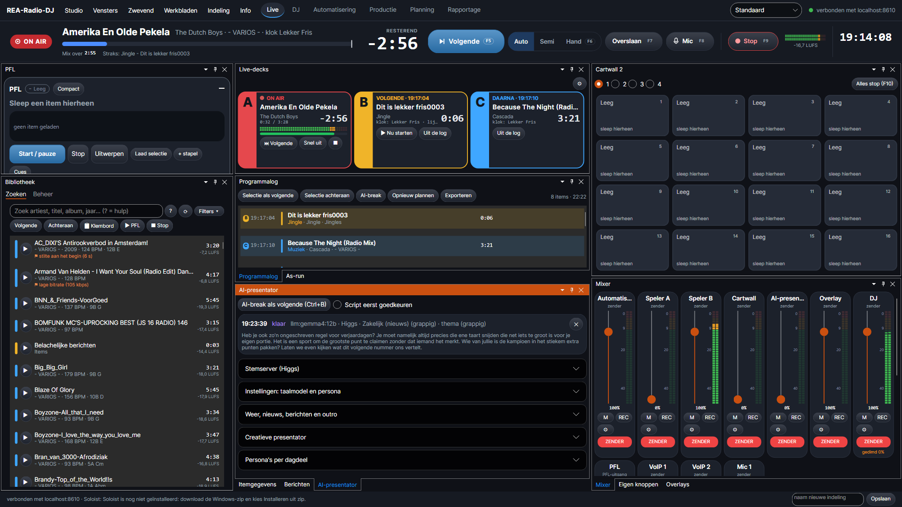
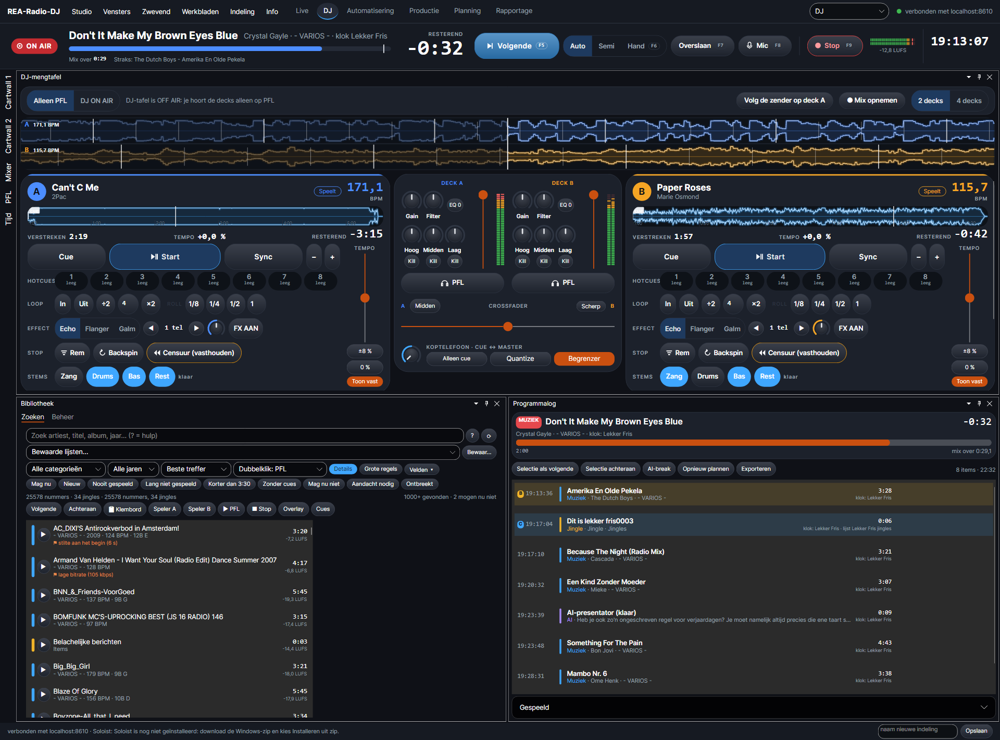
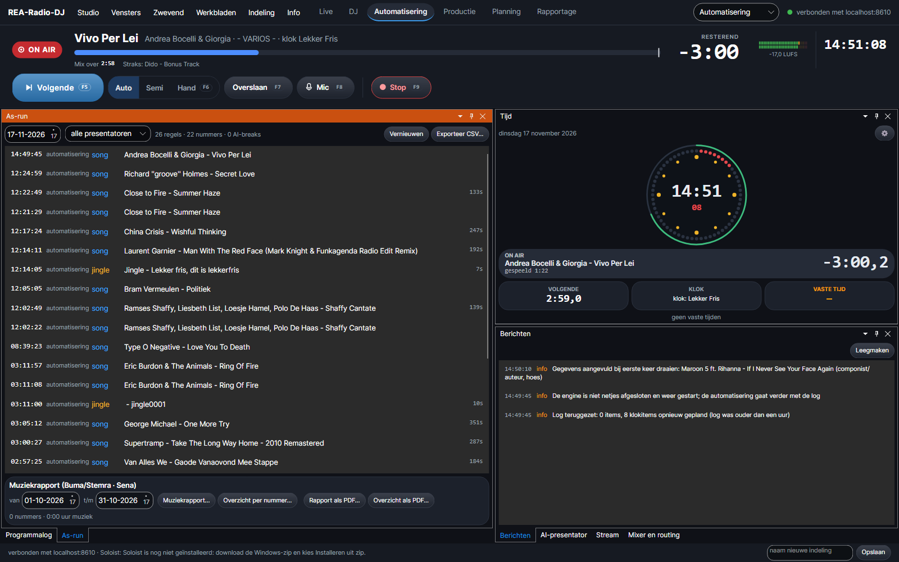
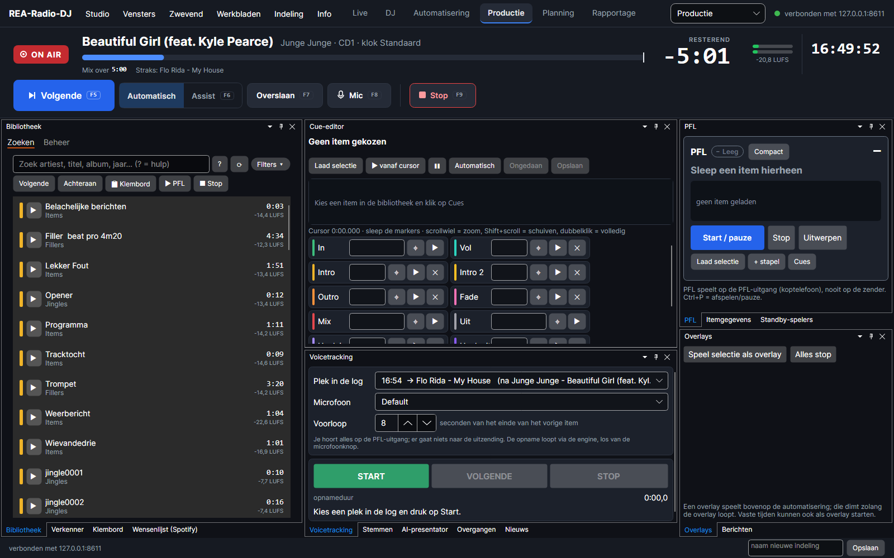
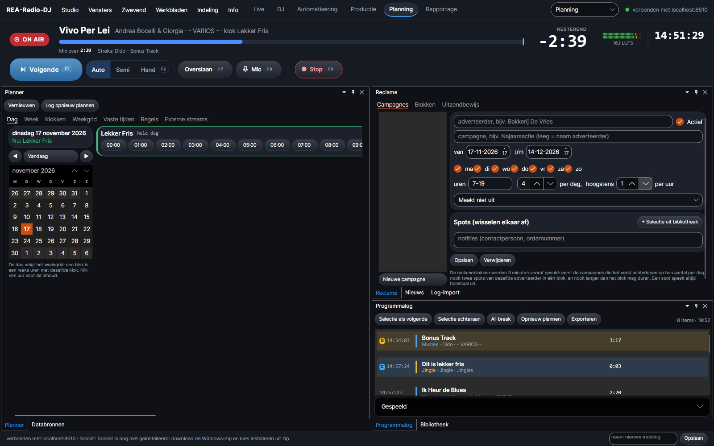
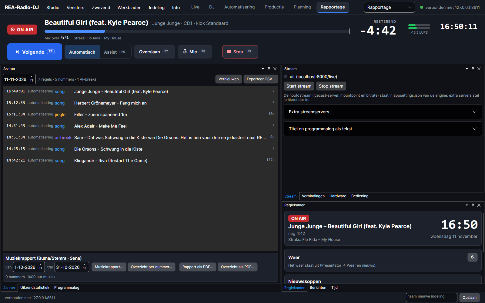
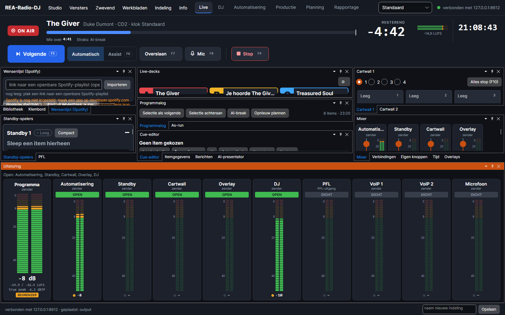
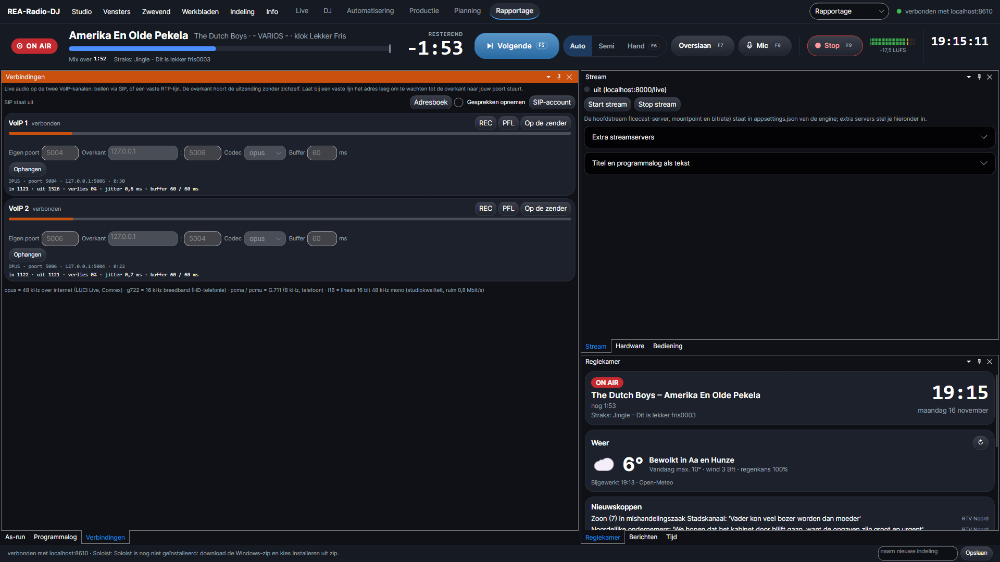

# REA-Radio-DJ

[Nederlands](README.md) · [English](README.en.md) · [Deutsch](README.de.md) · **Español**

Playout de radio libre con un presentador de IA integrado, hecho para Radio Aa en Hunze. Un motor de playout
independiente (servicio) y un estudio de escritorio con ventanas que se mueven, se acoplan y flotan libremente. Música
24/7 en automático o asistencia en directo, con relojes, horas fijas, cartwalls, reproductores de standby y PFL, un modo
DJ con cuatro platos, dos canales VoIP para oyentes y reporteros, y control por MIDI, Livewire, Ember+, OSC y TCP.

El estudio, las páginas web y el menú del motor junto al reloj hablan neerlandés, inglés, alemán o español
(*Ajustes › Apariencia*); el presentador de IA habla su propio idioma en antena.

> Estado: en desarrollo (prueba de concepto). Todavía no pensado para una emisora real. Lo que está listo y lo que queda
> pendiente está en [docs/WERKLIJST.md](docs/WERKLIJST.md) (en neerlandés).

Cómo se trabaja con él, en el estudio y como administrador, está en el [manual](docs/MANUAL.en.md) (en inglés).

## Capturas de pantalla



| | |
|---|---|
|  |  |
| **Modo DJ**: platos con forma de onda y líneas de beat, stems (voz, batería, bajo, resto), mezclador y efectos | **Automatización**: pauta con presentador de IA, reloj y mensajes |
|  |  |
| **Producción**: biblioteca, editor de cues, voicetracking y PFL | **Planificación**: día, semana, relojes y horas fijas, campañas publicitarias |
|  |  |
| **Informes**: as-run, informe musical (CSV y PDF), stream y sala de control | **Salidas**: programa con loudness y por canal un medidor con ABIERTO/CERRADO |
|  | |
| **Conexiones**: dos líneas VoIP, aquí con Opus, con pérdida, jitter y búfer | |

Cada ventana se puede arrastrar, acoplar o dejar flotando, también en una segunda pantalla.

## Qué hace

### Emisión y fiabilidad
- **Motor como servicio**: `REA-Radio-DJ.exe` reproduce la emisión, también con el estudio cerrado. Todo se controla por
  REST (`/api/...`), con estado en directo por WebSocket (`/api/ws`) o server-sent events (`/api/events`).
- **Watchdog**: un pequeño proceso vigilante reinicia el motor tras un fallo o un bloqueo, y sigue donde estaba la
  pauta. El motor puede arrancar con Windows, independientemente del estudio.
- **Vigilancia de la tarjeta de sonido**: si Windows u otro programa baja o silencia la tarjeta de la emisora, aparece
  un aviso, o el motor la restablece al momento. Si una tarjeta ASIO se detiene mientras suena, el motor la reinicia y
  lo avisa; si no vuelve, lo intenta cada 10 segundos.
- **Inicio suave con límite**: un bloque suave de noticias o publicidad espera al final del elemento, pero como mucho lo
  que esté ajustado (*Ajustes › Mezcla*); si tarda más, el bloque empieza al momento y el elemento se desvanece.
- **Duración por tipo y categoría**: una duración máxima (p. ej. jingles de 30 segundos como mucho), y elementos cortos
  que siempre suenan enteros sin fundido.
- **Texto del presentador**: por canción, anuncio o aviso un texto que dices con él; mientras suena el elemento se ve
  grande en la barra Live.
- **Detección de silencio** en antena: umbral, duración y acción (avisar, iniciar la automatización o reproducir algo
  de una categoría de emergencia).
- **Estudio de reserva**: un segundo motor vigila el estudio principal y toma la emisión si este falla, avisa de una
  avería o (si lo eliges) se queda en silencio; cuando el principal vuelve a sonar, devuelve la antena tras un tiempo
  ajustado o con un botón (*Ajustes › Estudio de reserva*).
- **Copia de seguridad** de ajustes, relojes, planificación, cartwalls y hardware en un solo archivo, y un registro del
  sistema en el estudio. El motor puede hacerlo **cada día automáticamente** a una hora fija, en una carpeta de otro
  disco o un NAS, con un plazo de conservación; una noche perdida se recupera (*Ajustes › Sistema*).
- **Resumen de puertos**: qué puertos usa el motor (de entrada o salida, solo este PC o la red), con un comando de
  PowerShell para el firewall que abre solo los puertos necesarios (*Ajustes › Sistema*).
- **Avisos por correo** (SMTP): silencio en antena, el estudio de reserva que toma el control, una copia de seguridad
  fallida, una tarjeta ASIO que se cae o un marcador sin audio, también fuera del estudio. Como máximo un correo por
  tema cada tantos minutos (*Ajustes › Avisos por correo*).
- **Comprobación de la base de datos antes de actualizar**: el motor comprueba la base de datos y hace una copia
  antes de actualizarla. Si está dañada, no se toca y el motor explica claramente qué pasa.
  `REA-Radio-DJ.exe --check-db` lo comprueba de antemano.

### Playout y planificación
- **Mezclador BASS** (coma flotante de 32 bits), crossfades en el punto de mezcla, normalización de loudness a −16 LUFS
  (EBU R128), transiciones y puntos de mezcla por tipo de elemento y por canción.
- **Relojes horarios y rejilla semanal**, con horas fijas: *dura* (al segundo), *suave* (tras la canción actual) u
  *overlay* (por encima, la música baja). Reglas de rotación, **contenedores** (un bloque como una sola línea en la
  pauta) y **streams externos** que toman el programa en una franja horaria.
- **Lista de reproducción como fuente** en un reloj: un hueco reproduce la siguiente canción (o una al azar) de un
  archivo M3U, PLS o XSPF, también si otro programa escribe esa lista. Solo suenan archivos de la biblioteca;
  *Comprobar* muestra cuántos son.
- **Eventos en un punto de una canción**: una envolvente de volumen o un comando en un momento, en el editor de cues.
- **Modos AUTO, SEMI y MANUAL**: la pauta avanza sola, tú entras (la pauta espera a tu propia canción), o lo inicias todo
  tú. La pauta puede ir **bajo los faders**: música en el reproductor A/B, jingles en la cartwall y breaks de IA en el
  presentador de IA, cada uno con su propio fader que se mueve con ellos.
- **Reproductores de estudio**: reproductores de standby con pila, un reproductor PFL, cartwalls de 4 × 16 botones,
  overlays y un portapapeles para aparcar canciones.

### Biblioteca
- **Biblioteca SQLite** con el modelo de cues completo (cue in, intros, outro, mezcla, cue out, hook) y un editor de
  cues con forma de onda.
- **Vigilar carpetas y recursos compartidos**: los archivos nuevos, cambiados y borrados se procesan solos; los
  archivos movidos se encuentran de nuevo con sus cues e historial.
- **Medir al importar**: BPM y rejilla de beats, tonalidad, ReplayGain, curva de loudness y marcas estimadas de intro y
  outro, además de un control de calidad (demasiado bajo, clipping, silencio, bitrate bajo, canciones duplicadas).
- **Búsqueda** sin acentos y con pequeñas erratas, filtros cortos (`bpm:120-128`, `jaar:198`, `duur:<3:30`), botones de
  filtro, listas inteligentes, «¿puede sonar ahora?» por canción y un panel de detalle. Rápido con 100.000 canciones.
- **Identificar por el sonido**: con AcoustID una canción se reconoce primero por su huella, luego por sus etiquetas; las
  canciones que pronto entran en la pauta se buscan de antemano, para que la portada y los datos estén a tiempo.
- **Archivos sueltos** puestos en la pauta o un reproductor desde el Explorador van a la categoría *Archivos sueltos*
  (fuera de la rotación) y así también reciben portada y metadatos.
- **Leer y reescribir etiquetas**, portadas, más campos (ISRC, compositor, editorial) y deshacer.

### Mezclador y sonido
- **Canales de mezcla** para automatización, standby, cartwalls, overlays, DJ, micrófonos, entrada de línea, VoIP y
  preescucha, cada uno a su propia tarjeta de Windows, par de canales o salida ASIO.
- **Tira de canal** por canal: ganancia, balance, ecualizador, compresor, control automático de nivel, silencio, a
  antena, grabar (REC), un efecto integrado y huecos para efectos VST.
- **Medidores LED** en dBFS con retención de pico en los platos, el mezclador, la tira DJ y la barra superior; el plato
  en antena tiene una barra de señal y avisa *sin sonido* si se queda en silencio.
- **Ventana Salidas**: el programa con pico, loudness (corto e integrado), true peak y limitador, y por canal un medidor
  grande con una luz ABIERTO, CERRADO o MIC ABIERTO; legible desde el otro lado del estudio.
- **Máster** con limitador y medidor de loudness. Modo *software* (el motor mezcla) o *mesa de mezclas* (cada canal a su
  propia salida).

### Modo DJ
- Cuatro platos con formas de onda en movimiento y líneas de beat, sync, hot cues, loops y loop roll, quantize, efectos
  al beat, censura, freno y backspin, un sampler, cue mix en los auriculares y un limitador.
- **Stems**: por plato voz, batería, bajo y el resto por separado, por ejemplo para una versión instrumental. Se generan
  en segundo plano en el procesador (HT-Demucs, con prioridad baja) y se guardan hasta 20 GB. El modelo
  (`data\models\htdemucs.onnx`) no viene en la descarga.
- **Automix** en 2 o 4 platos con tipos de transición (también con los faders de canal), y la automatización sigue sin
  oírse mientras el DJ está en antena.
- Grabar una mezcla; control de los platos por el bus de comandos y aprendizaje MIDI. *Aún no escuchado.*

### Conexiones (VoIP)
- Dos canales de mezcla VoIP con su propio fader, preescucha y un retorno sin ellos mismos (mix-minus).
- **RTP** en ambos sentidos con Opus (48 kHz), G.722 (16 kHz banda ancha), G.711 (A-law, µ-law) y PCM lineal, con búfer
  de jitter y medición; con Opus el propio códec rellena un paquete perdido.
- **SIP**: llamar, recibir llamadas y registrarse en una centralita, con soporte NAT. *Aún no probado con el
  proveedor.*
- **Agenda** con estaciones (número SIP o línea RTP fija), señales al sonar y al conectar, luces y tallies, y **grabar
  llamadas** (a mano o automáticamente, con plazo de conservación).

### Grabar, emitir en streaming e informes
- La emisión como MP3 por hora de reloj y el micrófono aparte, opcionalmente directo a la biblioteca, con plazo de
  conservación.
- **Grabar solo lo hablado** como control: el micrófono o una entrada, solo mientras está abierto y hay sonido (umbral y
  tiempo de cola), con medio segundo antes del inicio; un MP3 por hora sin la música de en medio.
- **Recortar de la emisión**: la entrevista de hace un momento como elemento en la biblioteca. Elige un día y una hora
  de inicio y de fin (o *últimos 10 min*); el fragmento puede pasar de la hora. Funciona con la grabación de la emisión
  (Ajustes › Grabar).
- **Grabaciones programadas** de una entrada o un stream de internet, por ejemplo las noticias regionales a las 12:00
  cada día laborable, listas en la biblioteca. Con *Sustituir la anterior* sigue siendo el mismo elemento, siempre con
  la grabación más reciente (ventana *Grabaciones*).
- **Grabación de emergencia**: un botón (o `RECORD TOGGLE`) graba todo lo que entra, cada canal por separado.
- **A la carta y podcast**: tras cada emisión de un programa, un episodio de la grabación de la emisión, con un feed
  RSS (`/podcast/<id>/feed.xml`) y, si quieres, una copia en una carpeta de tu web.
- **Marcadores**: programar una cuña (u otro elemento) aunque el audio aún tenga que llegar, con un aviso un día antes
  y una alarma si no está a tiempo.
- **Streams** a varios servidores Icecast y SHOUTcast a la vez, con actualización de títulos en un formato propio.
- **Imprimir o exportar la pauta** (PDF y CSV) con las horas de inicio previstas: *Pauta de emisión › Exportar*.
- **As-run** y una pauta como archivo de texto por día; informes de derechos de autor (CSV y PDF), informes de emisión de
  publicidad por anunciante y estadísticas de emisión.

### Presentador de IA
- Texto mediante cualquier endpoint compatible con OpenAI (p. ej. Ollama) o plantillas integradas, voz mediante Higgs
  TTS 3 o la voz de Windows. Los breaks se preparan con antelación; la emisión nunca espera a la IA.
- **Idioma en antena**: neerlandés, inglés, alemán o español, a elegir junto al nombre del presentador; el modelo de
  lenguaje, las plantillas, las noticias y el tiempo lo siguen.
- **Base de datos de voces**: un presentador graba su propia voz (micrófono del estudio) o sube una, con papeles de
  presentador, lector de noticias y presentador del tiempo; el servidor Higgs puede arrancar con el motor.
- Un presentador creativo que enlaza los discos, también con modelos de lenguaje que razonan.
- **Noticias y tiempo con IA** como bloque fijo: fuentes nacionales (p. ej. la NOS) y regionales (p. ej. RTV Drenthe),
  reescritas por el modelo de lenguaje local en un boletín con fuentes, o un parte del tiempo para un lugar elegido. Voz
  propia, cama musical debajo, apertura y cierre; p. ej. regional a las :30 y nacional a las :00. Si el modelo menciona
  algo que no está en la fuente (una cifra), los titulares se leen tal cual.

### Control y hardware
- Todo como comando de texto: por HTTP, TCP, UDP, OSC, atajos de teclado (también fuera del estudio), botones propios,
  el planificador y eventos (inicio de un elemento, micrófono abierto, stream caído).
- **Hardware**: MIDI, puertos serie, GPIO de Livewire y Ember+, para botones, luces y tallies. *Ember+ aún no se ha
  probado con un aparato real.*
- **Mackie Control**: una superficie de control con faders motorizados (p. ej. iCON V1-M, con una extensión como la V1-X
  al lado) maneja el mezclador: volumen, balance, silencio, grabar y a antena por canal, con pantalla y medidores; los
  faders siguen al estudio. En una iCON V1-M, REA carga su propia distribución en la superficie, con las canciones por
  fader en la pantalla, una distribución DJ con inicio por fader y la rueda jog por la pauta. Probado con una iCON V1-M.

### El estudio
- **Https en la red** con un certificado propio de la emisora (puerto 8443), y **voicetracking desde el navegador**: un
  presentador graba en casa una locución con el micrófono del portátil o del teléfono.
- **Biblioteca central**: un motor importa y mide la música; otros estudios lo adoptan y reproducen desde el recurso
  compartido o desde una copia propia (*Ajustes › Biblioteca central*).
- **A distancia**: una página para teléfono y tableta (`/remote/` en el motor) muestra lo que suena y lo que viene, con
  botones grandes para iniciar, saltar y carts. Leer se puede desde cualquier ordenador; cada acción por la red pide un
  usuario conectado o la contraseña de control.
- **Relojes de estudio** en tres estilos: analógico y digital juntos, un reloj LED con puntos de segundos, y un reloj
  horario que cuenta atrás hasta la hora en punto.
- Un asistente de configuración al primer inicio: nombre de la emisora, estilo de color, carpetas de música y jingles y
  tarjetas de sonido en cuatro pasos (luego en *Estudio › Asistente de configuración*).
- Espacios de trabajo Live, DJ, Automatización, Producción, Planificación e Informes, con hojas de trabajo por pantalla.
- Varios temas (oscuro, claro y más), tamaño de letra y escala ajustables, un modo táctil y colores por tipo de
  elemento.
- **Usuarios y permisos**: iniciar sesión con nombre propio y PIN, papeles presentador, técnico y administrador
  (*Ajustes › Usuarios*); los ajustes quedan entonces solo para administradores. *Estudio › Bloquear estudio* (Ctrl+L)
  mantiene la emisión y el estudio cerrado hasta el PIN; el as-run muestra por presentador lo que se emitió. Una cuenta
  puede tener un **último día** (becario, sustituto); después esa persona ya no puede iniciar sesión y se cierra su
  sesión. A quien lo deja se le puede desactivar en lugar de borrar. Tras un número ajustable de PIN erróneos, un nombre
  queda bloqueado un tiempo; un administrador puede levantarlo. PIN olvidado: inicia el motor en ese ordenador con
  `--users-off`.

## Instalación (Windows 10/11, x64)

Cada [versión](https://github.com/jerrydeevee/REA-Radio-DJ/releases) tiene un zip; desde la 1.1.0 también un instalador
(`REA-Radio-DJ-<versión>-setup.exe`). No hace falta instalar .NET aparte.

- El instalador instala para el usuario actual, sin derechos de administrador, en
  `%LocalAppData%\Programs\REA-Radio-DJ`. El motor guarda su base de datos, música y grabaciones junto a sí mismo
  (`engine\data`, `engine\media`).
- El instalador pone REA-Radio-DJ en el menú Inicio (estudio, motor e interfaz web). Un acceso directo en el escritorio y
  arrancar el motor al iniciar sesión son opciones del instalador.
- Un instalador más nuevo instala encima del antiguo. Desinstalar se hace en Configuración de Windows › Aplicaciones: el
  motor se detiene, y `engine\data` y `engine\media` se conservan.
- El estudio avisa de una versión más nueva abajo a la derecha (Info › Buscar actualizaciones).

Crear un instalador se hace con [Inno Setup 6](https://jrsoftware.org/isinfo.php):
`powershell -ExecutionPolicy Bypass -File scripts\build-installer.ps1` (BASS debe estar en `native\`).

## Inicio rápido desde el código fuente

1. Instala el [SDK de .NET 9](https://dotnet.microsoft.com/download).
2. Descarga BASS (no viene en el repositorio):
   ```powershell
   powershell -ExecutionPolicy Bypass -File scripts\fetch-bass.ps1
   ```
3. Inicia el motor con audio de demostración generado (incluido un evento de noticias cada hora a las :00):
   ```powershell
   dotnet run --project src\ReaRadioDj.Server -- --demo
   ```
4. Inicia el estudio:
   ```powershell
   dotnet run --project src\ReaRadioDj.Studio -- --lang es
   ```
   El estudio se conecta a `http://127.0.0.1:8600`. Si el motor no está en marcha, puedes iniciarlo desde el menú
   *Estudio*. Hay una interfaz web sencilla en <http://localhost:8600>.

Música propia: pon archivos (mp3, wav, flac, ogg, aiff) en subcarpetas de `media\music` (cada carpeta es una categoría)
y jingles en `media\jingles`, junto al lugar donde inicias el motor, o ajusta otras carpetas en `appsettings.json`.

### El estudio

- Cada ventana (pauta, reproductores, cartwalls, biblioteca, editor de cues, mezclador, planificador, as-run …) se puede
  arrastrar, acoplar en paralelo o como pestaña, o dejar flotando (menú *Flotante*), también en una segunda pantalla.
- Menú *Diseño*: guardar, cargar y restablecer diseños. El último diseño se guarda al salir.
- Arrastrar desde la biblioteca a la pauta, un reproductor o un botón de cart; doble clic = preescucha (PFL).
- Atajos: F5 siguiente, F6 automático/asistencia, F8 micrófono, F9 detener.
- Opciones: `--engine <url>`, `--no-engine`, `--profile <carpeta>` (carpeta de ajustes propia), `--lang <nl|en|de|es>`,
  `--show <ventana>`, `--float <ventana>`, `--workspace <live|dj|auto|prod|plan|report>`, `--setup` (abrir el asistente
  de configuración).

## Ajustes

Todo está en [`src/ReaRadioDj.Server/appsettings.json`](src/ReaRadioDj.Server/appsettings.json), sección `ReaRadioDj`.
Puedes sobrescribirlo todo con variables de entorno, por ejemplo `ReaRadioDj__OutputDevice=0`.

| Ajuste | Significado |
|---|---|
| `Language` | idioma del menú del motor junto al reloj (`nl`, `en`, `de`, `es`); vacío = el idioma de Windows |
| `OutputDevice` | `-1` tarjeta de sonido predeterminada, `0` sin tarjeta (solo streaming), `1..` un dispositivo concreto (ver `/api/devices`) |
| `Mix.TargetLufs` | loudness objetivo, por defecto −16 |
| `Rotation.ArtistSeparation` / `SongSeparation` | no el mismo artista / la misma canción en tantas canciones |
| `Routing.PreviewDevice` | tarjeta de sonido para PFL (preescucha) |
| `Routing.MicEnabled` / `MicDevice` / `MicDuckLevel` | grabar el micrófono, dispositivo de entrada, nivel de la música con el micrófono abierto |
| `Routing.OverlayDuckLevel` / `StandbyPlayers` | nivel de la música bajo los overlays, número de reproductores de standby |
| `Presenter.Language` | el idioma en antena del presentador de IA (`nl`, `en`, `de`, `es`) |
| `Presenter.Llm.BaseUrl` / `Model` | por ejemplo `http://localhost:11434` y `llama3.1` para Ollama; vacío = plantillas |
| `Presenter.Tts.Provider` | `sapi` (Windows) o `higgs` |
| `Presenter.Tts.BaseUrl` | servidor Higgs, por defecto `http://localhost:8001` |
| `Presenter.Tts.Tags` | etiquetas de control de Higgs antes de cada break, p. ej. `<\|emotion:enthusiasm\|>`; por voz en la ventana *Voz* |
| `Stream.*` | servidor Icecast (`host:port/mount`), contraseña, bitrate |

### Usar Higgs TTS 3

Higgs funciona como servidor aparte (SGLang-Omni) en WSL con una GPU NVIDIA. Los scripts están en `tools/higgs`:

```bash
# en WSL (Ubuntu): una vez un compilador de C, luego el servidor y el modelo (~9 GB) en ~/higgs
sudo apt-get install -y build-essential
mkdir -p ~/higgs && cp tools/higgs/*.sh ~/higgs/ && bash ~/higgs/install.sh
bash ~/higgs/pin.sh      # serie RTX 50: igualar el compilador CUDA con el runtime CUDA 13.0
~/higgs/start.sh         # servidor en el puerto 8001; clips de referencia en ~/higgs/voices
```

El estudio también puede iniciar y detener el servidor (ventana *Voz*): `Presenter.Tts.ServerCommand` es `wsl.exe` con
`-d Ubuntu -- bash -lc ~/higgs/start.sh`; con `StartServer` = `true` arranca con el motor. Ten en cuenta la licencia del
modelo: *Boson Higgs TTS 3 Research and Non-Commercial License*.

Después pon `Presenter.Tts.Provider` en `higgs`. Para una voz propia rellena `ReferenceAudio` (una ruta o URL que el
**servidor** pueda leer) y `ReferenceText` (lo que se dice en ese fragmento). Si Higgs falla, REA-Radio-DJ vuelve a la
voz de Windows.

## Estructura

```
src/ReaRadioDj.Core       motor de audio y mezclador (BASS), análisis, biblioteca (SQLite), relojes, horas fijas,
                          reproductores de estudio, cartwall, platos DJ, VoIP (RTP, SIP), hardware, as-run,
                          presentador de IA, streams
src/ReaRadioDj.Contracts  los mensajes (DTO) entre motor y estudio, y las traducciones (strings.tsv)
src/ReaRadioDj.Server     el servicio del motor: REST, WebSocket, server-sent events, automatización, interfaz web
src/ReaRadioDj.Studio     el estudio de escritorio (Avalonia + Dock): ventanas acoplables y flotantes
tests/ReaRadioDj.Tests    pruebas unitarias y de audio (en el dispositivo "no sound" de BASS)
scripts/fetch-bass.ps1   descarga BASS en /native
scripts/strings.py       mantiene al día la tabla de traducciones
scripts/build-installer.ps1, installer/   crean el instalador de Windows (Inno Setup 6)
```

El mezclador consiste en mezcladores BASS anidados: salidas (emisión, PFL) → canales → fuentes. Un bucle de control de
10 ms inicia el siguiente elemento de la pauta en el punto de mezcla. El ducking (micrófono, overlays, breaks de IA) va
por canal con un motivo, para que varias causas no se estorben. El motor solo reproduce material que está listo.

## Traducciones

El texto neerlandés es la clave; [`strings.tsv`](src/ReaRadioDj.Contracts/Localization/strings.tsv) tiene al lado el
inglés, el alemán y el español. Tras añadir o cambiar textos: ejecuta `python scripts/strings.py` y rellena las celdas
vacías; una prueba falla mientras un texto que pide el código no tenga traducción.

## Pruebas

```powershell
dotnet test
```

Más de 700 pruebas cubren, entre otras cosas, puntos de cue, planificación de relojes, horas fijas, la base de datos, la
biblioteca y la búsqueda, el bus de comandos, señales de hardware, RTP y SIP, y las traducciones. Las pruebas de audio
solo se ejecutan si BASS está presente: reproducen audio real en el dispositivo silencioso (motor, cartwall, standby,
ducking, grabación, escaneo de la biblioteca) e inician un servidor Icecast falso para el stream.

Lo que solo se puede comprobar con los oídos o con equipos reales (modo DJ, noticias con IA, ASIO, SIP, Ember+, Mackie
Control) está en [docs/TESTPLAN.md](docs/TESTPLAN.md), con una lista para anotar los equipos probados.

## Licencia

GPL-3.0 o posterior, con un permiso adicional para enlazar con BASS. Consulta [NOTICE.md](NOTICE.md) para BASS, Higgs
TTS 3 y los demás componentes.

REA-Radio-DJ es un diseño propio. Funciona de forma parecida a programas de playout conocidos, pero no usa su código,
pantallas, nombres ni formatos de archivo.

## Control remoto

Todo lo que puedes hacer en el estudio también se puede con comandos de texto (`NEXT`, `AUTO OFF`, `CART 1 5`,
`MIC TOGGLE`, `VOLUME log 80`, `STREAM START` …). La lista está en el estudio en **Estudio › Control y atajos** y en
`GET /api/commands`. Los mismos comandos funcionan por:

- **HTTP**: `POST /api/command` con `{"text":"NEXT"}`, o una dirección web por botón: `/api/do/next`, `/api/do/cart/1/5`
- **TCP** (puerto 8601): un comando por línea, respuesta `OK …` o `ERR …`; con contraseña primero `AUTH <contraseña>`
- **Línea de comandos**: `rea-cmd NEXT`, `rea-cmd "AUTO OFF" "CART 1 5"` o `rea-cmd --file comandos.txt` (junto al
  motor). La contraseña viene de la variable de entorno `REA_CONTROL_PASSWORD`; código de salida 0 = todo OK, 1 = un
  comando dio ERR, 2 = sin conexión. Útil en el programador de tareas o un script.
- **OSC** (UDP 8602): `/rea/next`, `/rea/cart/1/5`, `/rea/mic/toggle`, `/rea/cmd "AUTO OFF"` (valor 0 = soltar, se ignora)
- **UDP** (puerto 8603): un comando por paquete, con respuesta
- **MIDI, serie, Livewire y Ember+**: botones y faders a un comando, luces y tallies a un estado
- **Atajos de teclado** en el estudio (libres de ajustar) y **horas fijas** en el planificador (acción *Ejecutar
  comando*)

Un mando remoto que solo puede hacer una parte (una tableta solo la cartwall, una caja de botones solo `NEXT`) se ajusta
en **Ajustes › A distancia › Mandos remotos con derechos propios**. Recibe una clave propia en lugar de la contraseña
(TCP `AUTH <clave>`, UDP `<clave> NEXT`, web `/api/do/next?key=<clave>`, `rea-cmd` mediante `REA_CONTROL_PASSWORD`) o se
reconoce sin clave por su dirección fija. Solo puede usar los grupos de comandos marcados; `STATUS` y `HELP` siempre se
permiten.

Por defecto esto solo escucha en este ordenador. Para la red, en `appsettings.json`:

```json
"ReaRadioDj": { "Control": { "BindAddress": "0.0.0.0", "TcpPort": 8601, "OscPort": 8602, "Password": "secreto" } }
```

El planificador conoce además **reglas** (p. ej. como mucho 2 de la misma categoría seguidas; saltar o aplazar) y
**streams externos**: una URL de Icecast/SHOUTcast que se vigila en una franja horaria y, en cuanto está en directo, toma
el programa o suena por encima.
