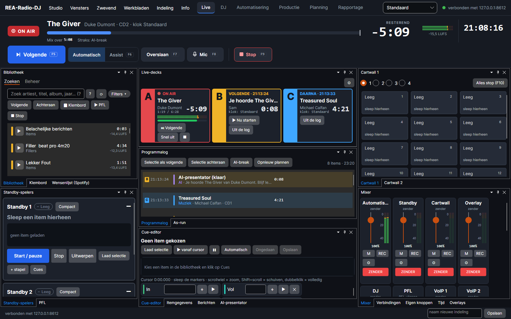
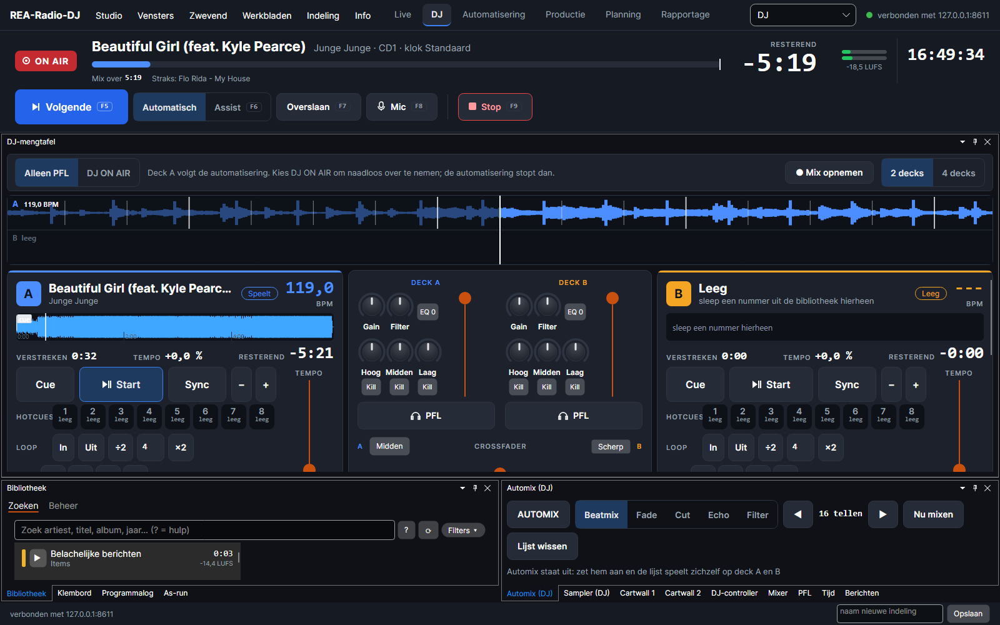
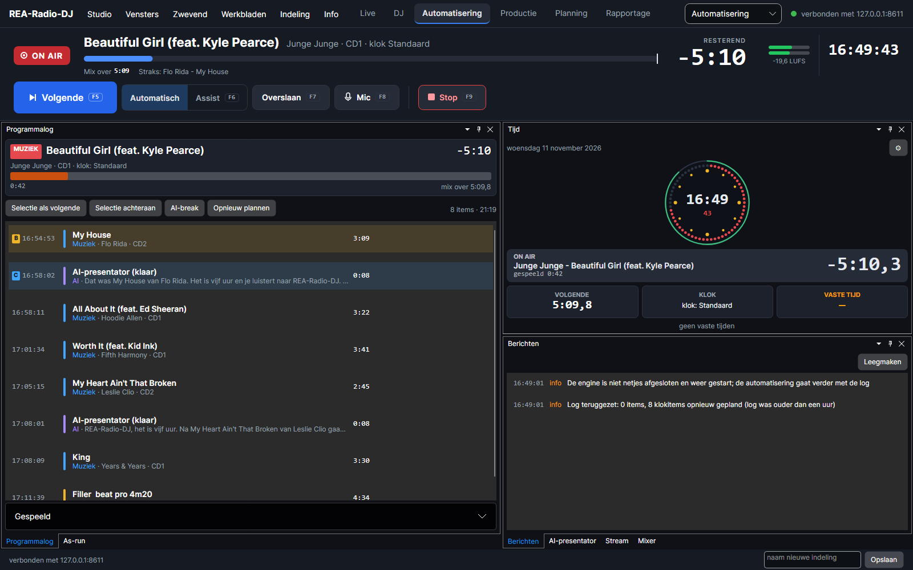
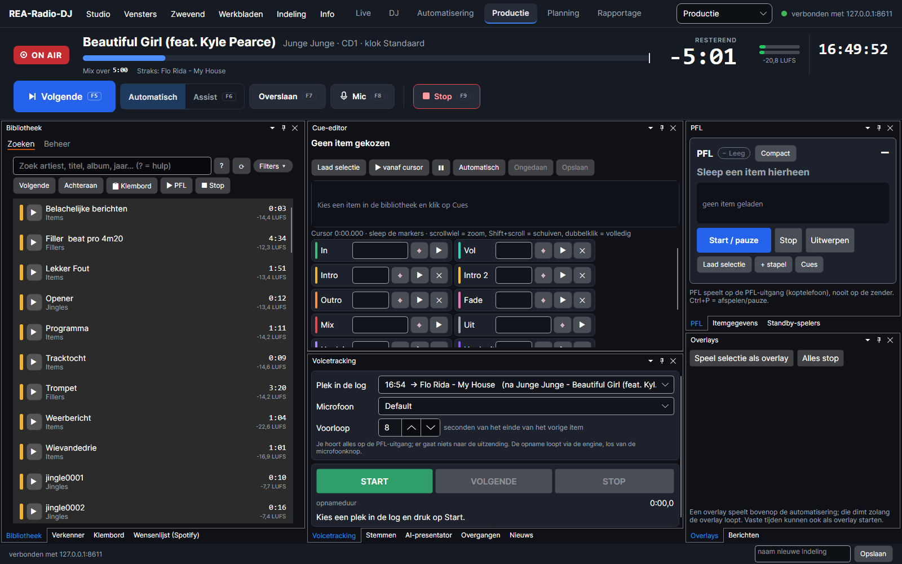
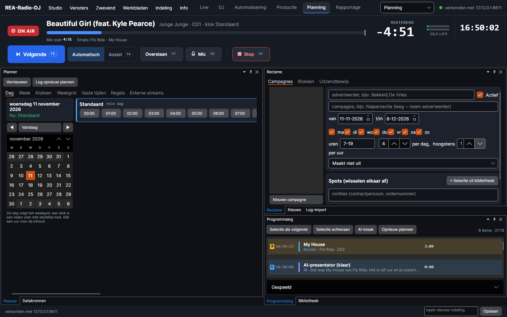
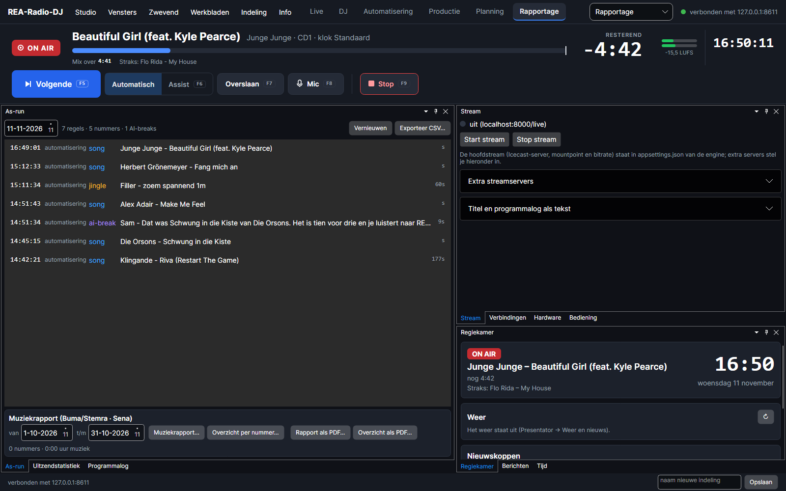

# REA-Radio-DJ

Vrije radio-playout met een ingebouwde AI-presentator, gemaakt voor Radio Aa en Hunze. Een losse playout-engine
(service) en een desktop-studio met vrij verplaatsbare, dokbare en zwevende vensters. Muziek 24/7 automatisch of
live-assist, met klokken, vaste tijden, cartwalls, standby- en PFL-spelers, een DJ-modus met vier decks, twee
VoIP-kanalen voor bellers en verslaggevers, en bediening via MIDI, Livewire, Ember+, OSC en TCP.

> Status: in ontwikkeling (proof of concept). Nog niet bedoeld voor een echte zender. Wat klaar is en wat nog
> open staat, staat in [docs/WERKLIJST.md](docs/WERKLIJST.md).

## Schermafdrukken



| | |
|---|---|
|  |  |
| **DJ-modus**: decks met golfvorm en beatstrepen, mengpaneel en automix | **Automatisering**: programmalog met AI-presentator, klok en berichten |
|  |  |
| **Productie**: bibliotheek, cue-editor, voicetracking en PFL | **Planning**: dag, week, klokken en vaste tijden, reclamecampagnes |
|  | |
| **Rapportage**: as-run, muziekrapport (CSV en PDF), stream en regiekamer | |

Elk venster is te verslepen, te docken of los te laten zweven, ook op een tweede scherm.

## Wat het kan

### Uitzending en bedrijfszekerheid
- **Engine als service**: `REA-Radio-DJ.exe` speelt de uitzending, ook als de studio dicht is. Alles is te bedienen
  via REST (`/api/...`), met live status via WebSocket (`/api/ws`) of server-sent events (`/api/events`).
- **Watchdog**: een klein bewakingsproces start de engine opnieuw na een crash of vastloper, en hij gaat verder waar
  de log was. De engine kan met Windows mee starten, los van de studio.
- **Stiltedetectie** op de zender: drempel, duur en actie (melden, automatisering starten of iets uit een
  noodcategorie spelen).
- **Reservekopie** van instellingen, klokken, planning, cartwalls en hardware in één bestand, en een systeemlog in
  de studio.

### Playout en planning
- **BASS-mixer** (32-bit float), crossfades op het mixpunt, loudness-normalisatie naar −16 LUFS (EBU R128),
  overgangen en mixpunten per soort item en per nummer.
- **Uurklokken en weekgrid**, met vaste tijden: *hard* (op de seconde), *zacht* (na het huidige nummer) of
  *overlay* (eroverheen, de muziek duikt). Regels voor de rotatie, **containers** (een blok als één regel in de log)
  en **externe streams** die in een tijdvenster het programma overnemen.
- **Gebeurtenissen op een plek in een nummer**: een volume-omhullende of een commando op een tijdstip, te zetten in
  de cue-editor.
- **Studio-spelers**: standby-spelers met stapel, een PFL-speler, cartwalls van 4 × 16 knoppen, overlays en een
  klembord om nummers te parkeren.

### Bibliotheek
- **SQLite-bibliotheek** met het volledige cuemodel (cue-in, intro's, outro, mix, cue-out, hook) en een
  cue-editor met golfvorm.
- **Mappen en shares bewaken**: nieuwe, gewijzigde en verwijderde bestanden worden vanzelf verwerkt; verplaatste
  bestanden worden teruggevonden met behoud van cues en geschiedenis.
- **Meten bij het inlezen**: BPM en beatgrid, toonsoort, ReplayGain, luidheidsverloop en geschatte intro- en
  outromarkers, plus een kwaliteitscontrole (te zacht, clipping, stilte, lage bitrate, dubbele nummers).
- **Zoeken** zonder accenten en met kleine tikfouten, korte filters (`bpm:120-128`, `jaar:198`, `duur:<3:30`),
  filterknoppen, slimme lijsten, "mag dit nu?" per nummer en een detailpaneel. Snel bij 100.000 nummers.
- **Tags lezen en terugschrijven**, hoezen, meer tagvelden (ISRC, componist, uitgever) en ongedaan maken.

### Mengpaneel en geluid
- **Mengkanalen** voor automatisering, standby, cartwalls, overlays, DJ, microfoons, lijn-in, VoIP en
  voorluisteren, elk naar een eigen Windows-kaart, kanaalpaar of ASIO-uitgang.
- **Kanaalstrip** per kanaal: gain, balans, equalizer, compressor, automatische niveauregeling, dempen, naar de
  zender, opnemen (REC), een ingebouwd effect en plekken voor VST-effecten.
- **Master** met begrenzer en loudness-meter. Werkwijze *software* (de engine mengt) of *mengtafel* (elk kanaal
  naar zijn eigen uitgang).

### DJ-modus
- Vier decks met doorlopende golfvormen en beatstrepen, sync, hot cues, loops en loop-roll, Quantize, effecten op
  de beat, censuur, rem en backspin, een sampler, cue-mix op de koptelefoon en een begrenzer.
- **Automix** met overgangstypes, en de automatisering loopt onhoorbaar door terwijl de DJ op de lucht is.
- Mix opnemen; bediening van decks via de commandobus en MIDI leren. *Nog niet beluisterd.*

### Verbindingen (VoIP)
- Twee VoIP-mengkanalen met eigen fader, voorluisteren en een terugkanaal zonder zichzelf (mix-minus).
- **RTP** in twee richtingen met G.711 (A-law, µ-law) en lineair PCM, met jitterbuffer en meting.
- **SIP**: bellen, gebeld worden en registreren bij een centrale, met NAT-ondersteuning. *Nog niet getest bij de
  aanbieder; Opus en G.722 volgen.*
- **Adresboek** met stations (SIP-nummer of vaste RTP-lijn), signalen bij overgaan en verbinden, lampjes en tallies,
  en **gesprekken opnemen** (met de hand of automatisch, met bewaartermijn).

### Opnemen, streamen en rapportage
- De uitzending als MP3 per klokuur en de microfoon apart, optioneel direct in de bibliotheek, met bewaartermijn.
- **Streams** naar meerdere Icecast- en SHOUTcast-servers tegelijk, met titelupdates in een eigen opmaak.
- **As-run** en een programmalog als tekstbestand per dag; rapportage auteursrechten (CSV en PDF),
  reclame-afspeelrapporten per adverteerder en uitzendstatistiek.

### AI-presentator
- Tekst via elk OpenAI-compatibel endpoint (bijv. Ollama) of ingebouwde sjablonen, stem via Higgs TTS 3 of
  Windows-spraak. Breaks worden vooraf gemaakt; de uitzending wacht nooit op de AI.
- Een creatieve presentator die de plaatjes aan elkaar praat, ook met denkende taalmodellen.

### Bediening en hardware
- Alles als tekstcommando: via HTTP, TCP, UDP, OSC, sneltoetsen (ook buiten de studio), eigen knoppen, de planner
  en gebeurtenissen (start van een item, microfoon open, stream weg).
- **Hardware**: MIDI, seriële poorten, Livewire-GPIO en Ember+, voor knoppen, lampjes en tallies.
  *Ember+ is nog niet tegen een echt apparaat getest.*

### De studio
- Een inrichthulp bij de eerste start: stationsnaam, kleurstijl, muziek- en jinglemap en geluidskaarten in vier
  stappen (later terug te vinden onder *Studio › Inrichthulp*).
- Werkruimtes Live, DJ, Automatisering, Productie, Planning en Rapportage, met werkbladen per scherm.
- Meerdere thema's (donker, licht en meer), instelbare lettergrootte en schaal, een aanraakmodus en kleuren per
  soort item.

## Installeren (Windows 10/11, x64)

Bij elke [uitgave](https://github.com/jerrydeevee/REA-Radio-DJ/releases) staat een zip; vanaf 1.1.0 ook een
setup (`REA-Radio-DJ-<versie>-setup.exe`). .NET hoeft niet apart geïnstalleerd te worden.

- De setup installeert voor de eigen gebruiker, zonder beheerdersrechten, in `%LocalAppData%\Programs\REA-Radio-DJ`.
  De engine bewaart zijn database, muziek en opnamen naast zichzelf (`engine\data`, `engine\media`).
- De setup zet REA-Radio-DJ in het Startmenu (studio, engine en web-interface). Een snelkoppeling op het
  bureaublad en het starten van de engine bij aanmelden zijn keuzes in de setup.
- Een nieuwere setup installeert over de oude heen. Verwijderen gaat via Windows-instellingen › Apps: de
  engine wordt gestopt, en `engine\data` en `engine\media` blijven staan.
- De studio meldt een nieuwere uitgave rechts onderin (Info › Zoeken naar updates).

Een setup bouwen kan met [Inno Setup 6](https://jrsoftware.org/isinfo.php):
`powershell -ExecutionPolicy Bypass -File scripts\build-installer.ps1` (BASS moet in `native\` staan).

## Snel starten vanuit de broncode

1. Installeer de [.NET 9 SDK](https://dotnet.microsoft.com/download).
2. Haal BASS op (komt niet mee in de repository):
   ```powershell
   powershell -ExecutionPolicy Bypass -File scripts\fetch-bass.ps1
   ```
3. Start de engine met gegenereerde demo-audio (inclusief een nieuws-event elk uur om :00):
   ```powershell
   dotnet run --project src\ReaRadioDj.Server -- --demo
   ```
4. Start de studio:
   ```powershell
   dotnet run --project src\ReaRadioDj.Studio
   ```
   De studio verbindt met `http://127.0.0.1:8600`. Draait de engine niet, dan kun je hem vanuit het menu
   *Studio* starten. Een eenvoudige web-interface staat op <http://localhost:8600>.

Eigen muziek: zet bestanden (mp3, wav, flac, ogg, aiff) in submappen van `media\music` (elke map wordt een
categorie) en jingles in `media\jingles`, naast de plek waar je de engine start, of stel andere mappen in via
`appsettings.json`.

### De studio

- Elk venster (log, spelers, cartwalls, bibliotheek, cue-editor, mixer, planner, as-run …) kun je verslepen,
  naast elkaar of als tabblad docken, of los laten zweven (menu *Zwevend*), ook op een tweede scherm.
- Menu *Indeling*: indelingen opslaan, laden en terugzetten. De laatste indeling wordt bij afsluiten bewaard.
- Slepen vanuit de bibliotheek naar log, speler of cartknop; dubbelklik = voorbeluisteren (PFL).
- Sneltoetsen: F5 volgende, F6 automatisch/assist, F8 microfoon, F9 stop.
- Opties: `--engine <url>`, `--no-engine`, `--profile <map>` (eigen instellingenmap), `--show <venster>`,
  `--float <venster>`, `--workspace <live|dj|auto|prod|plan|report>`, `--setup` (inrichthulp openen).

## Instellingen

Alles staat in [`src/ReaRadioDj.Server/appsettings.json`](src/ReaRadioDj.Server/appsettings.json), sectie `ReaRadioDj`.
Je kunt alles overschrijven met omgevingsvariabelen, bijvoorbeeld `ReaRadioDj__OutputDevice=0`.

| Instelling | Betekenis |
|---|---|
| `OutputDevice` | `-1` standaard geluidskaart, `0` geen geluidskaart (alleen streamen), `1..` een specifiek apparaat (zie `/api/devices`) |
| `Mix.TargetLufs` | doel-loudness, standaard −16 |
| `Rotation.ArtistSeparation` / `SongSeparation` | niet dezelfde artiest / hetzelfde nummer binnen zoveel nummers |
| `Routing.PreviewDevice` | geluidskaart voor PFL (voorbeluisteren) |
| `Routing.MicEnabled` / `MicDevice` / `MicDuckLevel` | microfoon opnemen, invoerapparaat, muziekniveau bij open microfoon |
| `Routing.OverlayDuckLevel` / `StandbyPlayers` | muziekniveau onder overlays, aantal standby-spelers |
| `Presenter.Llm.BaseUrl` / `Model` | bijvoorbeeld `http://localhost:11434` en `llama3.1` voor Ollama; leeg = sjablonen |
| `Presenter.Tts.Provider` | `sapi` (Windows) of `higgs` |
| `Presenter.Tts.BaseUrl` | Higgs-server, standaard `http://localhost:8001` |
| `Presenter.Tts.Tags` | Higgs-stuurtags vóór elke break, bijv. `<\|emotion:enthusiasm\|>`; per stem in te stellen in het venster *Stem* |
| `Stream.*` | Icecast-server (`host:port/mount`), wachtwoord, bitrate |

### Higgs TTS 3 gebruiken

Higgs draait als aparte server (SGLang-Omni) in WSL met een NVIDIA-GPU. De scripts staan in `tools/higgs`:

```bash
# in WSL (Ubuntu): eenmalig een C-compiler, daarna de server en het model (~9 GB) in ~/higgs
sudo apt-get install -y build-essential
mkdir -p ~/higgs && cp tools/higgs/*.sh ~/higgs/ && bash ~/higgs/install.sh
bash ~/higgs/pin.sh      # RTX 50-serie: CUDA-compiler gelijk zetten met de CUDA 13.0-runtime
~/higgs/start.sh         # server op poort 8001; referentieclips in ~/higgs/voices
```

De studio kan de server ook zelf starten en stoppen (venster *Stem*): `Presenter.Tts.ServerCommand` staat op
`wsl.exe` met `-d Ubuntu -- bash -lc ~/higgs/start.sh`; met `StartServer` = `true` start hij mee met de engine.
Let op de licentie van het model: *Boson Higgs TTS 3 Research and Non-Commercial License*.

Zet daarna `Presenter.Tts.Provider` op `higgs`. Voor een eigen stem vul je `ReferenceAudio` (een pad of URL die de
**server** kan lezen) en `ReferenceText` (wat er in dat fragment gezegd wordt) in. Faalt Higgs, dan valt
REA-Radio-DJ terug op Windows-spraak.

## Opbouw

```
src/ReaRadioDj.Core       audio-engine en mixer (BASS), analyse, bibliotheek (SQLite), klokken, vaste tijden,
                          studio-spelers, cartwall, DJ-decks, VoIP (RTP, SIP), hardware, as-run,
                          AI-presentator, streams
src/ReaRadioDj.Contracts  de berichten (DTO's) tussen engine en studio
src/ReaRadioDj.Server     de engine-service: REST, WebSocket, server-sent events, automatisering, web-UI
src/ReaRadioDj.Studio     de desktop-studio (Avalonia + Dock): dokbare en zwevende vensters
tests/ReaRadioDj.Tests    unit tests en audiotests (draaien op het "no sound"-apparaat van BASS)
scripts/fetch-bass.ps1   downloadt BASS naar /native
scripts/build-installer.ps1, installer/   bouwen de Windows-setup (Inno Setup 6)
```

De mixer bestaat uit geneste BASS-mixers: uitgangen (uitzending, PFL) → kanalen → bronnen. Een controlelus van
10 ms start het volgende log-item op het mixpunt. Ducken (microfoon, overlays, AI-breaks) gaat per kanaal met een
reden, zodat meerdere oorzaken elkaar niet in de weg zitten. De engine speelt alleen materiaal dat klaarstaat.

## Tests

```powershell
dotnet test
```

Bijna 400 tests dekken onder meer cuepunten, klokplanning, vaste tijden, de database, de bibliotheek en het zoeken,
de commandobus, hardwaresignalen, RTP en SIP. De audiotests draaien alleen als BASS aanwezig is: ze spelen echte
audio af op het stille apparaat (engine, cartwall, standby, ducken, opnemen, bibliotheekscan) en starten een
nep-Icecast-server voor de stream.

## Licentie

GPL-3.0 of later, met een aanvullende toestemming om met BASS te linken. Zie [NOTICE.md](NOTICE.md) voor BASS,
Higgs TTS 3 en de andere onderdelen.

REA-Radio-DJ is een eigen ontwerp. Het werkt functioneel vergelijkbaar met bekende playout-programma's, maar
gebruikt geen code, schermen, namen of bestandsformaten daarvan.

## Bediening op afstand

Alles wat je in de studio kunt, kan ook met tekstcommando's (`NEXT`, `AUTO OFF`, `CART 1 5`, `MIC TOGGLE`,
`VOLUME log 80`, `STREAM START` …). De lijst staat in de studio onder **Studio › Bediening en sneltoetsen** en op
`GET /api/commands`. Dezelfde commando's werken via:

- **HTTP**: `POST /api/command` met `{"text":"NEXT"}`, of een webadres per knop: `/api/do/next`, `/api/do/cart/1/5`
- **TCP** (poort 8601): één commando per regel, antwoord `OK …` of `ERR …`; met wachtwoord eerst `AUTH <wachtwoord>`
- **OSC** (UDP 8602): `/rea/next`, `/rea/cart/1/5`, `/rea/mic/toggle`, `/rea/cmd "AUTO OFF"` (waarde 0 = loslaten, genegeerd)
- **UDP** (poort 8603): één commando per pakket, met antwoord terug
- **MIDI, serieel, Livewire en Ember+**: knoppen en faders op een commando, lampjes en tallies op een toestand
- **Sneltoetsen** in de studio (vrij in te stellen) en **vaste tijden** in de planner (actie *Commando uitvoeren*)

Standaard luistert dit alleen op deze computer. Voor het netwerk in `appsettings.json`:

```json
"ReaRadioDj": { "Control": { "BindAddress": "0.0.0.0", "TcpPort": 8601, "OscPort": 8602, "Password": "geheim" } }
```

De planner kent verder **regels** (bijv. maximaal 2 uit dezelfde categorie op rij; overslaan of uitstellen) en
**externe streams**: een Icecast/SHOUTcast-URL die in een tijdvenster wordt bewaakt en, zodra hij live is, het
programma overneemt of eroverheen speelt.

